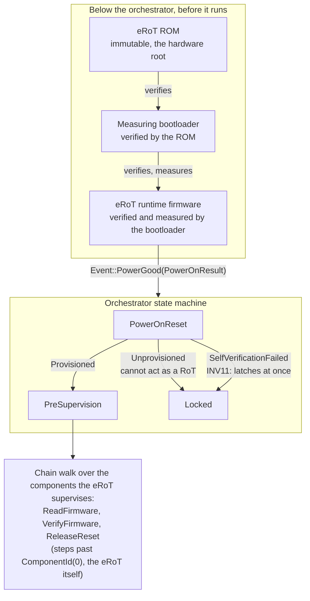

# How the eRoT's own firmware is verified

The orchestrator verifies every component it supervises: it reads the
firmware, verifies it at rest, releases the reset line and watches the boot
walk. It does none of that for the eRoT it runs on.

That is not a gap. The orchestrator is the thing that got booted, so it cannot
be the thing that decides whether booting it was safe. By the time any of this
code runs, the answer is already settled.

## Two different trust relationships

Governing other components is the orchestrator's job. It walks the chain,
reading and verifying each component before releasing it, and the
[state machine](orchestrator/orchestrator-machine.md) owns every step.

Self-governance happens one boot layer down, before the orchestrator exists.
The eRoT ROM verifies the bootloader, the bootloader verifies and measures the
runtime firmware, and only then does this code start. The orchestrator
receives a verdict it did not compute.

## What the orchestrator does with the verdict

The board hands it in as `PowerOnResult` inside `Event::PowerGood`, the first
event the machine ever sees. There are three answers:

| `PowerOnResult` | meaning | where it goes |
|---|---|---|
| `Provisioned` | self-verified, has an identity | `PreSupervision` |
| `Unprovisioned` | self-verified, but cannot act as a RoT | `Locked` |
| `SelfVerificationFailed` | the layer below said no | `Locked` |

`SelfVerificationFailed` latches `Locked` immediately, without passing through
`PreSupervision`. That is invariant INV11, pinned by
`self_verification_failure_latches_immediately`.

Producing the value is platform code's job. Nothing in this repository
constructs a `PowerOnResult` outside tests: the board's bring-up reads what
the ROM and the bootloader recorded (a status register, say, or the fact that
a fallback image is running) and names one of the three. Where the ROM
refuses to start an image that failed verification, `SelfVerificationFailed`
never arrives, because nothing is running to send it.

Refusing to run is the only move available. The orchestrator cannot re-verify
itself, so it cannot recover from a bad verdict, and a platform whose own RoT
is suspect has nothing left to supervise with.

## Why the walk skips chain position 0

The eRoT holds `ComponentId(0)` in every device table, so the orchestrator can
address it the way it addresses anything else. The walk steps past it: no
`ReadFirmware`, no `VerifyFirmware`, no `ReleaseReset`. There is nothing to
read or verify at rest, because that already happened, and nothing to release,
because the eRoT is what drives the reset lines.

The test `the_walk_passes_over_the_erot` pins both halves: a power-on walk
emits none of those three effects for the eRoT, and still reaches the
component behind it.

## The eRoT's own reset

A self-update activates a new image and resets the eRoT into it. The driver
does the sequence: it records the session with the SVN the verifier read off
the candidate, marks the trial pending, then asks the board's `SelfReset` to
reset.

The `SelfUpdate` session is durable: it survives the reset, and the next boot
reads it. NIST SP 800-193 §4.1.2(2) requires a mutable Root of Trust for
Update to stay operational or recoverable across the reboot its own update
causes, including after a power loss in the middle of a flash write, and the
session is what the eRoT recovers from.

The reset belongs to the platform. The eRoT's device table entry carries no
reset signal, because nothing outside the eRoT can reset it.

## Where the SVN comes from

A managed component's floor takes the SVN read back after the component
reboots, not the SVN read off the candidate. The two can differ: the
candidate is what the agent offered, the read-back is what runs. The
floor takes the read-back because the orchestrator verified it.

The eRoT has only the candidate's SVN. It could read its own flash, but
then the running image would vouch for itself, so the orchestrator never
verifies itself. The ROM and the bootloader verify it. They report a
verdict with no version: `PowerOnResult` is `Provisioned`, `Unprovisioned`
or `SelfVerificationFailed`.

`PollOutcome::Authenticated` carries the candidate's SVN. The activation
records it in the session. Confirming the trial does not move the floor.
The commit is a separate step, and it takes the SVN from the session.

An eRoT image carries its SVN in the signed header, and the ROM compares
that SVN against the anti-rollback counter before booting. An eRoT image
without an SVN cannot be compared, so the eRoT cannot install it. That is
why `SelfUpdate::prepare` takes an `Svn` and not an `Option<Svn>`: with no
SVN there is no session and no trial to mark, so the update is rejected.

A managed component needs no session, because the walk judges it after it
reboots. The image installs even with no SVN, and the anti-rollback floor
for that component stays where it was, which `Report::SvnFloorHeld`
records.

## Not covered here

The ROM and bootloader are platform firmware, outside this repository. How a
given platform verifies each layer, and where it keeps the keys to do so, is
that platform's business. This page only says what the orchestrator may assume
about the result and what it does when the result is bad.

Device identity and attestation key derivation are specified in
[Attestation](../specification/services/attestation.md).
