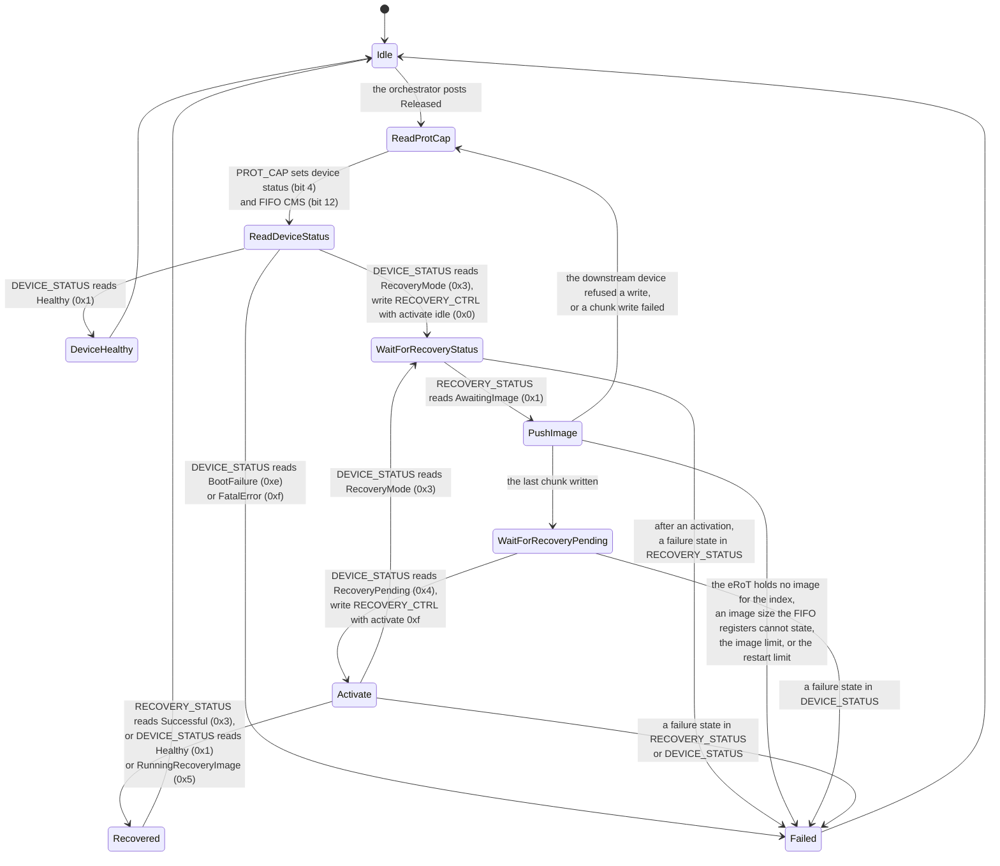

# OCP Recovery: the eRoT as Recovery Agent

On this page the eRoT is the Recovery Agent and a downstream device is
the Device. The downstream device serves the OCP Recovery registers, and
the eRoT reads the registers, pushes the image and requests the
activation. [OCP Recovery: the eRoT as Device](./ocp-recovery-device.md)
describes the opposite assignment, where the eRoT serves the registers
and another component on the platform is the Recovery Agent.

The role applies to a downstream device that serves OCP Recovery and
boots from an image a Recovery Agent streams, for example a CPU or a
NIC. Such a downstream device enters recovery mode after it failed to
boot from flash, or on every boot when it holds no image in flash. The
eRoT runs the same sequence in both cases. For a downstream device whose
boot flash the eRoT writes, the orchestrator restores the image through
the `Recovery` capability, and the eRoT sends no OCP Recovery command.

The register value names on this page follow the variants of
`DeviceStatus` and `RecoveryStatus` in `hal/blocking/ocp_recovery`, the
HAL for firmware on the Device side. Every value on this page follows
OCP Secure Firmware Recovery 1.2.

The eRoT sends each command through a driver that implements
`RegisterAccess`, as a block read or a block write over the bus that
connects the eRoT to the downstream device. Any bus with such a driver
carries the commands: I3C, SMBus, USB, I2C or another bus. The board
decides the bus, and the sequence stays the same on every bus.

## When the role runs

A downstream device in reset serves no registers. The orchestrator
keeps the reset line, and the Recovery Agent runs as an app outside the
orchestrator, because a push takes many register accesses and the
orchestrator loop waits for no other app. An IPC channel joins the
orchestrator and the Recovery Agent:

- The orchestrator posts `Held` when it holds the downstream device in
  reset through `BootControl::hold_in_reset`, and `Released` with a new
  boot cycle number when it releases the downstream device through
  `BootControl::release`. A post never waits for the Recovery Agent, and
  a newer post replaces a post the Recovery Agent has not taken yet.
- The Recovery Agent sends a report with the boot cycle number of the
  last `Released` post and the status of the push, once after each
  change of the status. The orchestrator drops a report with an older
  boot cycle number.

After a `Released` post the Recovery Agent runs 1 recovery for the boot
cycle, and after an end state the Recovery Agent makes no register
access until the next `Released` post. A `Held` post stops the
recovery at once. The orchestrator reads the report as the boot
evidence of the downstream device and decides from the report whether
the downstream device booted:

| Report | `BootStatus` |
| --- | --- |
| none yet, or no end state | `Booting` |
| `Successful` in `RECOVERY_STATUS`, or `Healthy` or `RunningRecoveryImage` in `DEVICE_STATUS` | `Booted` |
| `AuthenticationError` in `RECOVERY_STATUS`, `FatalError` in `DEVICE_STATUS`, an image the eRoT does not hold, an image size the FIFO registers cannot state, the image limit | `FailedFatal` |
| every other failure state in `RECOVERY_STATUS` or `DEVICE_STATUS`, the restart limit | `FailedRetriable` |
| a failed read from the image source, which the Recovery Agent repeats | `Booting` |

A lost post or a Recovery Agent app that stopped keeps the evidence at
`Booting`, and the checkpoint timeout of the downstream device ends the
wait. A downstream device that reports no end state also reads
`Booting` until the checkpoint timeout. For such a downstream device
the board compares the count of activated images in the report with the
count of images the board expects, or reads the boot evidence from
another signal of the downstream device.

Where OCP Recovery loads only the first firmware stage and the
downstream device loads the rest over PLDM firmware update, the
downstream device needs a second checkpoint after the push.

The role does not sit behind `Recovery::restore`. The orchestrator
holds the managed device in reset before it calls `restore`, and a
downstream device in reset serves no registers, so an implementor of
`restore` would have to release the downstream device inside the
call.

## The Recovery Agent sequence

The sequence follows the Recovery Agent in the Caliptra MCU SW BMC
emulator (`caliptra-mcu-sw/emulator/bmc/src/recovery.rs`) and adds the
failure paths. The eRoT runs the sequence as one flow of reads and
writes, and the diagram shows each step and each poll as a state. In
each read state, the value the eRoT reads decides the transition.

The Recovery Agent starts every transfer, so the eRoT polls. A state
repeats its read until the register value matches a transition. A
`PROT_CAP` with bit 4 or bit 12 clear keeps the eRoT in `ReadProtCap`.
Before the first activation, a failure state in `RECOVERY_STATUS` keeps
the eRoT in `WaitForRecoveryStatus`, because the downstream device can
still hold the failure state of an earlier sequence.

For the push in `PushImage`, the eRoT writes `INDIRECT_FIFO_CTRL` with
the reset and the image size, reads `INDIRECT_FIFO_CTRL` back to compare
the image size, then writes `INDIRECT_FIFO_DATA` in chunks the size
`INDIRECT_FIFO_STATUS` advertises. Before each chunk the eRoT waits for
the EMPTY bit, which is stricter than the rule of 1.2 (write while FULL
is clear) and still valid. After each chunk the eRoT reads
`DEVICE_STATUS` for a protocol error. The eRoT pushes only through the
FIFO (`0x2d` to `0x2f`), which a Caliptra subsystem serves, and sends no
indirect memory window command (`0x29` to `0x2b`). The emulator Recovery
Agent checks `PROT_CAP` bit 4 only. OCP Secure Firmware Recovery 1.2
allows the FIFO commands only where bit 12 is set, so the eRoT checks
bit 12 in `ReadProtCap` as well.

A failed access repeats the same step, except in the chunk write. When
the downstream device refuses a write, when the read back of
`INDIRECT_FIFO_CTRL` returns another image size, or when a chunk write
fails on the bus, the eRoT drops the sequence and starts again at
`ReadProtCap`. In 1.2 a NACK rejects the whole transfer, so a NACK on a
chunk write takes the same restart. The new announcement resets the
FIFO, so the downstream device stages every chunk once.

`PushLimits` bounds what the eRoT does in 1 boot cycle, and the board
configuration sets the values. After `max_restarts` restarts the eRoT
reports the restart limit and stops the recovery. When the downstream
device requests an image after `max_images` activations, the eRoT
pushes nothing, reports the image limit and stops the recovery. Without
the limits, a boot attempt that ends in a checkpoint timeout would keep
the eRoT pushing, because the orchestrator posts no `Held` for a
downstream device that it does not put back in reset.

A downstream device that boots from several images returns to
`RecoveryMode` after an activation and reports the next recovery image
index in `RECOVERY_STATUS`. The transition from `Activate` back to
`WaitForRecoveryStatus` serves that downstream device, and the eRoT
pushes the image the index names. A Caliptra subsystem requests the
Caliptra firmware at index 0, the SoC manifest at index 1 and the MCU
firmware at index 2. At the end of cold boot, the MCU ROM in
caliptra-mcu-sw writes a `RECOVERY_STATUS` of `Successful` by default,
which ends the sequence. With the ROM parameter `recovery_status_open`,
the MCU ROM writes a `RECOVERY_STATUS` of `BootingImage` and no
`DEVICE_STATUS`, so the eRoT reports no end state, and the board reads
the boot evidence from the count of activated images or from another
signal, as for any downstream device without an end state.

The host tests run the sequence against a mock downstream device that
implements `RegisterAccess` and calls `dispatch` of the Device side
directly, so the tests need no IPC channel to a downstream device.

## Open questions

- Does the eRoT pad the last chunk? The eRoT sends a short last chunk.
  The Caliptra FPGA model in caliptra-sw pads every image to a multiple
  of 256 bytes, with the note that the last chunk does not finish
  otherwise.
- Does the eRoT cap a chunk at the FIFO size minus 1 entry? In 1.2 the
  FIFO keeps 1 entry free, and the eRoT sends chunks of the max transfer
  size. Whether Caliptra core takes a chunk 1 entry shorter has no test
  yet.
- Where does the eRoT get the images, and does the eRoT verify an image
  before pushing the image? Issue #705 collects both questions.

## Gaps

- The orchestrator runs as an app and talks to other apps over IPC only
  on the `ocp-global-demo-wip` branch. `main` holds neither the Recovery
  Agent app nor the IPC channel to the orchestrator.
- The eRoT does not write `DEVICE_RESET` to the downstream device yet,
  so the orchestrator resets the downstream device only through the
  reset line.
- The HAL names the value 0xe of `RECOVERY_STATUS`
  `ErrorEnteringRecovery`, and the register crate
  `services/ocp-recovery/api` names the value `EnterRecoveryError`.
