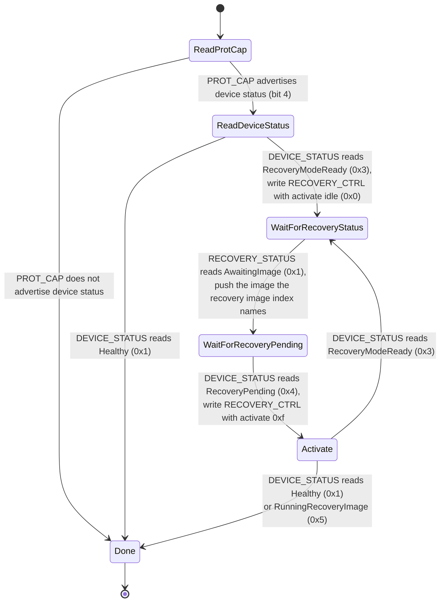

# OCP Recovery: the eRoT as Recovery Agent

On this page the eRoT is the Recovery Agent and a downstream device is
the Device. The downstream device serves the OCP Recovery registers, and
the eRoT reads the registers, pushes the image and requests the
activation. [OCP Recovery Streaming Boot](./ocp-recovery.md) describes
the opposite assignment, where the eRoT serves the registers and another
component on the platform is the Recovery Agent.

The role applies to a downstream device that serves OCP Recovery and
boots from an image a Recovery Agent streams, for example a CPU or a
NIC. Such a downstream device enters recovery mode after it failed to
boot from flash, or on every boot when it holds no image in flash. The
eRoT runs the same sequence in both cases. For a downstream device whose
boot flash the eRoT writes, the orchestrator restores the image through
the `Recovery` capability, and the eRoT sends no OCP Recovery command.

Both roles share the wire layer. `services/ocp-recovery/api` holds the
command byte values and the packed register layouts, so the eRoT encodes
each write and decodes each read with the types the serving side uses.
Every value on this page follows OCP Secure Firmware Recovery 1.1.

The transport binding is out of scope here. The eRoT sends block reads
and block writes as the bus controller, and which bus carries them is an
open question below.

## When the role runs

A downstream device in reset serves no registers. While the eRoT is in
recovery mode, the eRoT holds every downstream device in reset through
`BootControl::hold_in_reset`. The eRoT starts the Recovery Agent
sequence for a downstream device after the eRoT boots a verified image
and releases that downstream device from reset.

## The Recovery Agent sequence

The sequence follows the Recovery Agent in the Caliptra MCU SW BMC
emulator (`caliptra-mcu-sw/emulator/bmc/src/recovery.rs`). The eRoT runs
the sequence as one flow of reads and writes, as the Device flow in
[OCP Recovery Streaming Boot](./ocp-recovery.md) does, and the diagram
shows each step and each poll as a state. Each state names the register
the eRoT reads next, and the value the eRoT reads decides the
transition.

The downstream device raises no interrupt, so the eRoT polls. A state
repeats its read until the value matches a transition.

The push in `WaitForRecoveryStatus` follows the streaming-boot sequence
in [OCP Recovery Streaming Boot](./ocp-recovery.md) with the eRoT on the
Recovery Agent side: the eRoT writes `INDIRECT_FIFO_CTRL` with the image
size, then writes `INDIRECT_FIFO_DATA` in chunks the size
`INDIRECT_FIFO_STATUS` advertises. The eRoT pushes only through the
FIFO (`0x2d` to `0x2f`), which a Caliptra subsystem serves, and sends
no indirect memory window command (`0x29` to `0x2b`).

A downstream device that boots from several images returns to
`RecoveryModeReady` after an activation and reports the next recovery
image index in `RECOVERY_STATUS`. The transition from `Activate` back to
`WaitForRecoveryStatus` serves that downstream device, and the eRoT
pushes the image the index names. A Caliptra subsystem requests the
Caliptra firmware at index 0, the SoC manifest at index 1 and the MCU
firmware at index 2. As the Device, the eRoT reports image 0
throughout. As the Recovery Agent, the eRoT follows the index the
downstream device reports.

## Open questions

- Does the role sit behind `Recovery::restore`? The orchestrator calls
  `restore` to rewrite the active image of a managed device, and the
  verifier judges the restored image on the re-walk. A downstream device
  that serves OCP Recovery verifies the pushed image and reports the
  verdict in `RECOVERY_STATUS`. Either an implementor of `Recovery` runs
  the sequence and maps that verdict to the result of `restore`, or the
  orchestrator drives the role through a separate capability.
- How does the eRoT get the images? The images come from the BMC or a
  rack manager, and the eRoT needs every image the downstream device
  requests by index. The eRoT can store the images in flash ahead of a
  recovery, where the flash size bounds them, or fetch each image when
  the downstream device requests the image. The protocol that carries
  an image to the eRoT is open as well.
- Does the eRoT verify an image before pushing it? The downstream device
  verifies the image either way. A verify on the eRoT keeps a corrupt
  stored image off the bus and costs the eRoT a verifier for an image
  format the downstream device defines.
- Which transport carries the controller side? A downstream device
  that carries a Caliptra subsystem serves the registers through an I3C
  core, so the eRoT needs an I3C controller to recover that downstream
  device. Other downstream devices may serve the registers over SMBus.
- Which failure paths does the sequence need? The emulator Recovery
  Agent has no transition for a `DEVICE_STATUS` of `BootFailure` (0xe)
  or `FatalError` (0xf), for a `RECOVERY_STATUS` that reports a failed
  or refused image, for a latched protocol error, or for a downstream
  device that stops answering. The sequence needs an end state for a
  failed recovery, a poll period, a timeout per state and a retry
  count, and a decision on whether the eRoT puts a downstream device
  that failed recovery back in reset.
- What does the eRoT do when the downstream device answers a push with
  a NACK? The eRoT can send the same write again, start the image again
  with an `INDIRECT_FIFO_CTRL` reset, or end the recovery as failed.
- What does the eRoT do when the recovery image index names an image
  the eRoT does not hold? The emulator Recovery Agent returns an error
  and stays in `WaitForRecoveryStatus`.
