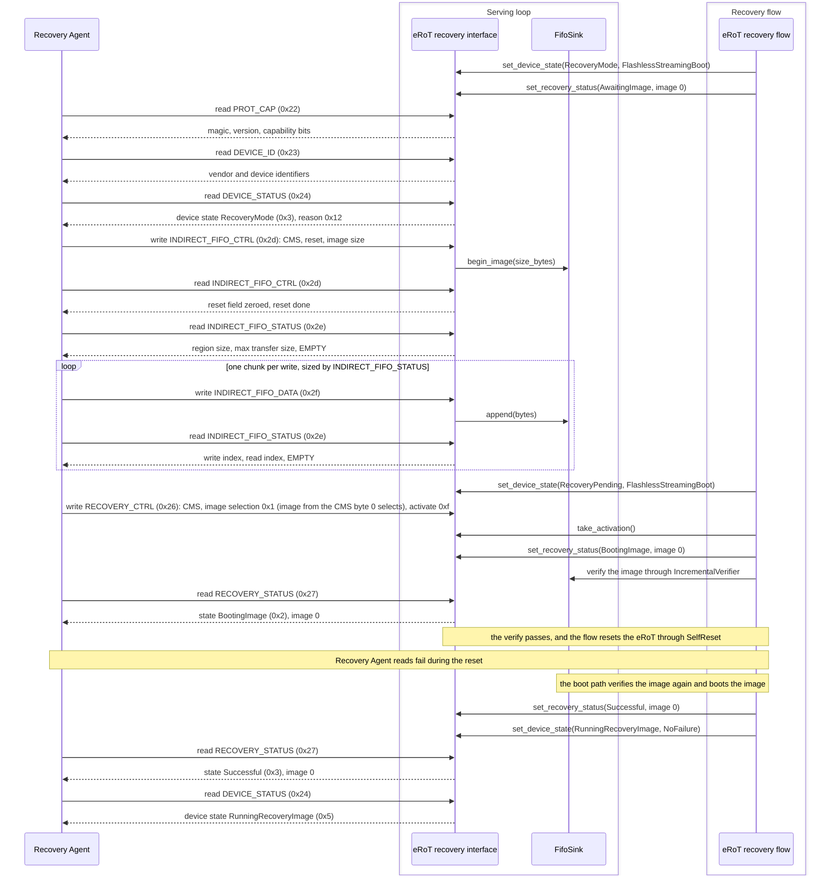
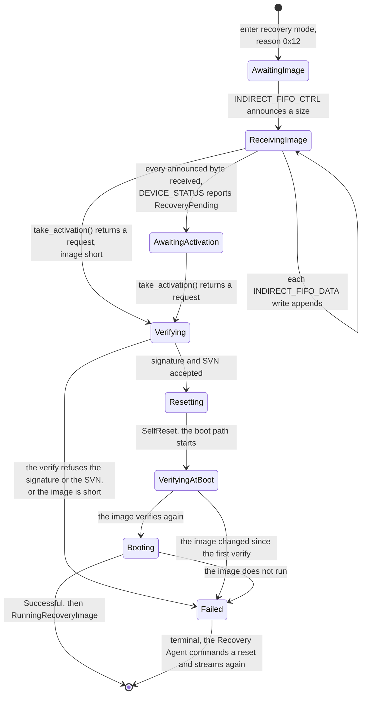
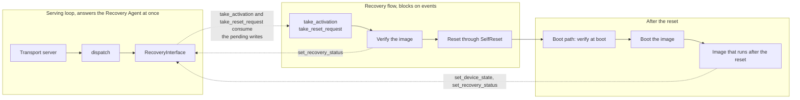

# OCP Recovery: the eRoT as Device

The eRoT serves the OCP Recovery interface as the Device, and a
Recovery Agent on the platform drives it. The Recovery Agent pushes the
bytes and requests the activation, and the Device verifies the image and
boots or refuses it.
[OCP Recovery: the eRoT as Recovery Agent](./ocp-recovery-agent.md)
describes the second role, where the eRoT is the Recovery Agent for a
downstream device.

The boot selector in the eRoT walks a ladder of boot sources: the active
slot with its retries, the other slots, a golden copy where the board
declares one, then the OCP recovery firmware. The last rung lets the
eRoT enter streaming boot without intervention by a person. The OCP
recovery firmware is a separate signed image that serves the OCP
Recovery interface and verifies the image the Recovery Agent streams. Which rungs exist, and
their order, is board configuration. A technician with physical access
to the board can still set the hardware strap, which the chip samples
at power-on, before the boot selector runs. The strap is a service path
outside this design. The `Recovery` capability is a separate mechanism:
the orchestrator drives the `Recovery` capability to recover managed
devices, and the eRoT is not a managed device.

The Recovery Agent for the eRoT has to run without depending on the
eRoT. The eRoT releases the BMC from reset, so a BMC waits for the eRoT
and cannot push an image to an eRoT in recovery mode. A rack manager,
or another component that boots independently of the eRoT, takes the
Recovery Agent role.

This design covers the device layer below any transport. The serving
function `dispatch` in `services/ocp-recovery/server` takes a command
byte and a payload and leaves the framing to the transport server, so
any transport whose server feeds `dispatch` works: I3C, SMBus, USB, I2C
or another bus. Whether a `dispatch` in firmware answers a read in time
depends on the transport, and issue #744 collects the questions on I3C
read timing.

## The wire layer

`services/ocp-recovery/api` holds the wire layer: the command byte
values `0x22` through `0x2f`, the access rule, the accepted length and
the scope for each one, and a packed layout per register.
`apply_agent_write` validates every byte of a write before storing any,
so when `apply_agent_write` refuses a write, the target register keeps
the bytes it held. A Recovery Agent that gets a refusal can send the
whole write again, because no field of the write took effect. The
Device advertises `OCP RECV` as the `PROT_CAP` magic and version 1.2.
Every value in this document follows OCP Secure
Firmware Recovery 1.2.

`services/ocp-recovery/server` holds the registers and the dispatch
function. `RecoveryInterface` holds the single copy of the register
state, `dispatch` serves one Recovery Agent read or write against it,
and `FifoSink` is the seam the streamed bytes leave through. A
`FifoSink` that also implements `ByteSource` lets the verifier read the
image back.

## The staging region

The board configuration names the staging region, the storage the
`FifoSink` writes the streamed image to. The board builds the `FifoSink`
over that region and derives the FIFO region size and the `PROT_CAP`
capability bits from the same entry. The storage has to keep the image
across the reset before the boot, only the eRoT may write the storage,
and the storage has to hold the largest image the board accepts.

## The streaming-boot sequence

The Recovery Agent starts every transfer, so the Recovery Agent finds
out by polling that the eRoT entered recovery mode: `DEVICE_STATUS`
answers `RecoveryMode` with the reason. The Device increments the
heartbeat field in `DEVICE_STATUS` while it runs. When `DEVICE_STATUS`
reads `RecoveryMode` on every poll, a heartbeat that changes between 2
polls tells the Recovery Agent that the Device waits for bytes, and a
heartbeat that stays the same tells the Recovery Agent that the Device
has stopped. A board that serves the interface declares its heartbeat
period in `PROT_CAP` byte 14, and the value has to be non-zero, because
0 is the spec value for a Device that sends no heartbeat. When the
Recovery Agent starts polling, how often it polls and how many times it
streams again are Recovery Agent policy, outside this design.

The serving loop and the recovery flow of the OCP recovery firmware run
as separate execution contexts. The interface and the `FifoSink` hold
state that the serving loop writes inside each `dispatch` call, so
every arrow the Recovery Agent starts is work the serving loop does,
the `begin_image` and `append` calls into the `FifoSink` included. The arrows the recovery flow starts run in the
recovery flow, which blocks on `take_activation` while the serving loop
keeps answering the Recovery Agent. The Recovery Agent polls, so a read
that lands before a recovery-flow update returns the older value, and
the diagram shows the poll that lands after.

After the reset, the "eRoT recovery flow" and "eRoT recovery interface"
lifelines stand for the image that runs after the reset.

In 1.2 the FIFO keeps 1 entry free, so the FIFO holds at most its size
minus 1 entry, and a Recovery Agent that paces by polling writes a
chunk while the FULL bit of `INDIRECT_FIFO_STATUS` is clear. The spec also lets an agent pace on a
NACK, or on the gap between the write index and the read index. How the
FIFO reads after a push depends on the `FifoSink`. A `FifoSink` that
takes each chunk inside `append`, while `dispatch` handles the
`INDIRECT_FIFO_DATA` write that carried the chunk, leaves the FIFO
empty with both indices equal after every push. A `FifoSink` that takes
chunks later leaves the chunk in the FIFO, so the Device sets FULL while
the FIFO has no room for another chunk.

`INDIRECT_FIFO_CTRL` and `INDIRECT_FIFO_STATUS` count 4-byte units, so
the image size, the region size, the max transfer size and both indices
are 4-byte counts on the wire and the server converts them to bytes.

The announced size bounds the push. `begin_image` refuses a size larger
than the `FifoSink` holds, and `dispatch` refuses the whole of a write
that would carry the received bytes past the announced size: the
`FifoSink` keeps the bytes it holds, the indices do not move, and
`dispatch` latches a protocol error the next `DEVICE_STATUS` read
returns. An agent that overran writes `INDIRECT_FIFO_CTRL` again with
the reset field set, which discards the received image and announces
the new size.

## Verifying the streamed image

The Device treats the transport as unauthenticated, so the Device cannot
tell whether the bytes it received came from the Recovery Agent. The
Device verifies the image after the push, executes only bytes that a
verify covered, and keeps unverified bytes out of executable memory.

The verify step runs through `IncrementalVerifier`. The flow starts a
session and polls it over the image as a `ByteSource`, and an
`Authenticated` outcome carries the `AuthenticatedImage` that reports
the SVN. The flow compares that SVN against the SVN floor of the eRoT,
which `ErotUpdate` names as `SvnFloor`, not against the SVN floor the
orchestrator reads for a managed device.

The flow verifies the image, resets the eRoT through `SelfReset`, and
the boot path verifies the image again before booting the image. The
staging region can change after the verify before the reset, by an
attack or by accident, so the verify at boot covers the bytes the boot
runs.

If the streamed image fails after it boots, the Recovery Agent commands
a reset over `DEVICE_RESET` and streams again. The flow takes that
command with `take_reset_request` and performs the reset through
`SelfReset`.

Proposed mapping from the verify outcome to `RECOVERY_STATUS` and
`DEVICE_STATUS`. The spec leaves the reason code to the Device:

| Verify outcome | RECOVERY_STATUS state | DEVICE_STATUS state and reason |
| --- | --- | --- |
| Image passes the verify before the reset and the verify at boot, and boots | `Successful` (0x3) | `RunningRecoveryImage` (0x5), no reason code |
| Signature does not verify | `AuthenticationError` (0xd) | `BootFailure` (0xe), `RecoveryFirmwareAuthFailure` (0xf) |
| The verify at boot refuses the image | `AuthenticationError` (0xd) | `BootFailure` (0xe), `RecoveryFirmwareAuthFailure` (0xf) |
| Image SVN below the SVN floor | `Failed` (0xc) | `BootFailure` (0xe), `RecoveryFirmwareRollback` (0x10) |
| Image malformed or short | `Failed` (0xc) | `BootFailure` (0xe), `RecoveryFirmwareMissing` (0xe) |
| Device cannot enter recovery | `ErrorEnteringRecovery` (0xe) | `BootFailure` (0xe), `GenericHardwareError` (0x1) |

Only `RecoveryMode`, `RecoveryPending` and `BootFailure` carry a
reason code, and the interface stores 0 for every other state. The last
row reports the failure through `BootFailure` rather than `FatalError`.
The spec calls a fatal error not recoverable through the OCP flow and
populates no reason code for it, so a Recovery Agent reading `FatalError`
stops pushing images, while `BootFailure` carries the reason code that
says what to fix.

The image that runs after the reset writes the values of
the `Successful` row and of the row for the verify at boot.

The Recovery Agent clears a terminal state with the `DEVICE_RESET`
command, and the eRoT takes the request through `take_reset_request` and
resets itself. `RECOVERY_STATUS` is read-only on the wire, so only the
Device writes `RECOVERY_STATUS`.

## The execution model

The OCP recovery firmware runs the recovery sequence as its main flow,
in place of a recovery service or an event-driven state machine. The
flow runs straight through to the verify before the reset and blocks on
`take_activation` and `take_reset_request`, while the serving loop
keeps calling `dispatch`. After the reset, the boot path runs
the verify at boot and boots the image, and the image that runs after
the reset writes the status registers.

`RECOVERY_STATUS` names none of `Verifying`, `Resetting`,
`VerifyingAtBoot` and `Booting`. The recovery flow runs `Verifying` and
`Resetting`, and the boot path runs `VerifyingAtBoot` and `Booting`. The
flow writes `BootingImage` (0x2) when `take_activation` returns the
request, so a Recovery Agent that polls during the verify before the
reset reads `BootingImage`. Recovery Agent reads fail during the reset,
and the image that runs after the reset writes `Successful` or the
failure.

The serving loop and the recovery flow are split, so the recovery flow
can block without stalling the Recovery Agent:

The Recovery Agent polls `DEVICE_STATUS` and `INDIRECT_FIFO_STATUS` and
watches the heartbeat for as long as the flow runs, so the serving loop
must not block on the recovery flow. The hardware of a recovery block
answers the Recovery Agent whatever the firmware does, so the firmware
behind that recovery block can wait on the OCP Recovery registers in a
blocking loop. On the eRoT the firmware answers, so the recovery flow
blocks on events while the serving loop keeps answering, and
`tick_heartbeat` shows the Recovery Agent that the Device is alive.

Until a streamed image verifies and boots, every downstream device
stays in reset, and the OCP recovery firmware serves only the
interface.

## How this design relates to the HAL

`hal/blocking/ocp_recovery` is the HAL for firmware on a Device whose
recovery block answers the Recovery Agent in hardware, as on a Caliptra
subsystem. Through `RecoveryDriver`, that firmware sets the status
values and reads the image size, the FIFO and the activation request,
and `RecoveryDevice` runs the sequence for each image on top.

This page covers an eRoT without a recovery block. `RecoveryInterface`
and `dispatch` take the place of the recovery block, and the recovery
flow covers the steps of `RecoveryDevice`: the recovery flow reports
recovery mode and the awaited image, takes the image and waits for the
activation. The names of the `DEVICE_STATUS` and `RECOVERY_STATUS`
states on this page follow `DeviceStatus` and `RecoveryStatus` in the
HAL. The recovery flow differs from `RecoveryDevice` in these points:

- `RecoveryDevice` pulls the image out of the FIFO in words through
  `read_fifo`, and `dispatch` pushes each chunk into the `FifoSink`.
- The recovery flow resets the eRoT between the verify and the boot, and
  `RecoveryDevice` has no step for a reset.
- `RecoveryDevice::complete` reports `Healthy`, and the recovery flow
  reports `RunningRecoveryImage`.
- After a failure, `RecoveryDevice::fail` reports `BootFailure`, and the
  next `request_image` reports `RecoveryMode` again with no reset. The
  recovery flow keeps `BootFailure` until the Recovery Agent sends
  `DEVICE_RESET`.
- `RecoveryDriver` has no call for `DEVICE_RESET`, the heartbeat or the
  protocol error.

## Which image serves the interface

Up to the reset before the boot, the OCP recovery firmware serves the
interface. The eRoT boots the OCP recovery firmware when every local
image failed, before the Recovery Agent sends any bytes. How the eRoT starts the OCP recovery firmware,
what the OCP recovery firmware contains and who may rewrite it are
questions in issue #705.

Whether a board serves OCP streaming at all is board configuration,
which a const function checks at build time, and a board that declares
nothing builds no serving flow.

## The scope rule and the protocol-error latch

Each command belongs to a group, and the group sets the states in which
`dispatch` serves the command. Commands `0x22` through `0x27`, which are
`PROT_CAP`, `DEVICE_ID`, `DEVICE_STATUS`, `DEVICE_RESET`,
`RECOVERY_CTRL` and `RECOVERY_STATUS`, are always available, and so is
`HW_STATUS` (`0x28`) on a board that advertises `PROT_CAP` bit 9.
`HW_STATUS` carries the composite temperature and the hardware error
bits, which a Recovery Agent reads while the eRoT runs normally, so
recovery mode does not gate it. The indirect memory window (`0x29` to
`0x2b`) and the vendor command (`0x2c`) are unsupported in every state,
and `dispatch` answers them with the unsupported-command error.

That leaves the FIFO group (`0x2d` to `0x2f`) as the one scoped group.
It is available while `DEVICE_STATUS` byte 0 reads `RecoveryMode` (0x3)
or `RecoveryPending` (0x4), and only when `PROT_CAP` bit 12, FIFO CMS
support, is set. `dispatch` refuses the FIFO group in every other state,
`Healthy` (0x1) and `RunningRecoveryImage` (0x5) included: the first
means the Device runs outside recovery mode, and the second means the
streamed image already runs and the FIFO holds nothing the agent can
use.

`dispatch` latches a protocol error for each refused FIFO command. The
spec gives the FIFO commands scope R, which means that the Device serves
the FIFO commands at any non-zero `DEVICE_STATUS`, so this refusal
departs from the spec. Outside recovery the FIFO registers carry no image
size, no indices and no staged bytes, and an agent that reads them
learns nothing.

`BootFailure` (0xe) is neither `RecoveryMode` nor
`RecoveryPending`, so `dispatch` refuses the FIFO commands after the
verify refuses an image, and the agent commands `DEVICE_RESET` before it
announces a new size. The eRoT resets, re-enters recovery mode with an
empty `FifoSink` and writes `RecoveryMode`, and the agent streams
the corrected image from there.

A refusal changes no register except the error byte it latches.
`dispatch` validates access, length and every byte of the payload before
storing anything, latches a protocol error into `DEVICE_STATUS` byte 1,
and answers zero bytes. The latch clears when the Recovery Agent reads
`DEVICE_STATUS`, and the read returns the error that was latched before
the clear. A second error arriving before that read overwrites the first,
so the Recovery Agent sees the most recent one.

The protocol error values are the `ProtocolError` bytes in
`services/ocp-recovery/api`.

"Write 1, Device Clears" works on the whole field: the Device writes
the idle value back once it has acted, and it refuses a write of any
value the field does not name. The values differ per field.
`RECOVERY_CTRL` byte 2 takes `0xf` to activate and `0x0` for idle,
`INDIRECT_FIFO_CTRL` byte 1 takes `0x1` to reset the indices and `0x0`
for idle, and `DEVICE_RESET` byte 0 takes `0x1` for a device reset and
`0x2` for a management reset.

## Out of scope

Forced recovery is out of scope. Adopting forced recovery later costs a
configuration field plus the operational image serving the registers,
because the Recovery Agent writes the forced-recovery value to an eRoT
that runs normally. The interface decodes the forced-recovery value the agent
writes and keeps the value when `take_reset_request` clears the reset
control, so adopting forced recovery
later needs no change to the wire layer.

Multi-stage activation is out of scope. The spec has the Device
increment the recovery image index and return to awaiting an image when
a further stage follows a successful activation, so an agent streams one
stage after another. The eRoT accepts one streamed image and boots it,
and the flow reports image 0 throughout. The register file carries the
index field, so adopting stages later costs the flow a counter rather
than a wire change.

Also out of scope: the indirect memory window and the vendor command,
which `dispatch` refuses in every state and `PROT_CAP` does not
advertise, and the transport binding.

Downstream devices are out of scope on this page. The interface the
eRoT serves carries images for the eRoT only.
[OCP Recovery: the eRoT as Recovery Agent](./ocp-recovery-agent.md)
covers the eRoT as Recovery Agent for a downstream device that serves
OCP Recovery.

## Open questions

- Which image serves the interface after the reset? That image reports
  the outcome to the Recovery Agent, and the scope rule has a Recovery
  Agent read `Healthy` and `HW_STATUS` while the eRoT runs normally.
  The reset before the boot clears `RecoveryInterface`, and a refusal
  at the verify at boot needs a report of the refusal to the Recovery
  Agent as well. Issue #705 collects the record the eRoT keeps across
  the reset.
- Which state does the eRoT report after a streamed image boots? The
  spec has a Device that runs operational firmware report `Healthy`, and
  this design reports `RunningRecoveryImage`.
- Which reason code does the eRoT report on entering recovery? The
  diagrams report `FlashlessStreamingBoot` (0x12), which fits a Device
  that holds no local image. An eRoT whose local images failed still
  holds local images, so which reason fits that eRoT is open.
- Can the recovery flow run on `RecoveryDevice`, over a `RecoveryDriver`
  that `RecoveryInterface` implements? The eRoT and a Device with a
  recovery block would then share one sequence, and the differences
  under "How this design relates to the HAL" need an answer first.
- Does the design keep the FIFO refusal? The spec has the Device serve
  the FIFO commands at any non-zero `DEVICE_STATUS`, and this design
  serves the FIFO commands only in `RecoveryMode` and `RecoveryPending`.

Issue #705 collects the questions on the boot side and on platform
policy: the OCP recovery firmware, the boot order, the reset wiring,
`LockdownLatch`, the push mechanism, timing, and a small first image
that loads the rest over PLDM firmware update.

## Gaps

- This design names code that `main` does not hold yet: the crates
  under `services/ocp-recovery`. `IncrementalVerifier`, `SelfReset`,
  `ErotUpdate` and `AuthenticatedImage` exist on the
  `ocp-global-demo-wip` branch.
- The draft of the `services/ocp-recovery` crates advertises version
  1.1 in `PROT_CAP`, and `FifoSink` has no way to report that the FIFO
  is full, so a `FifoSink` that takes chunks later cannot set FULL.
