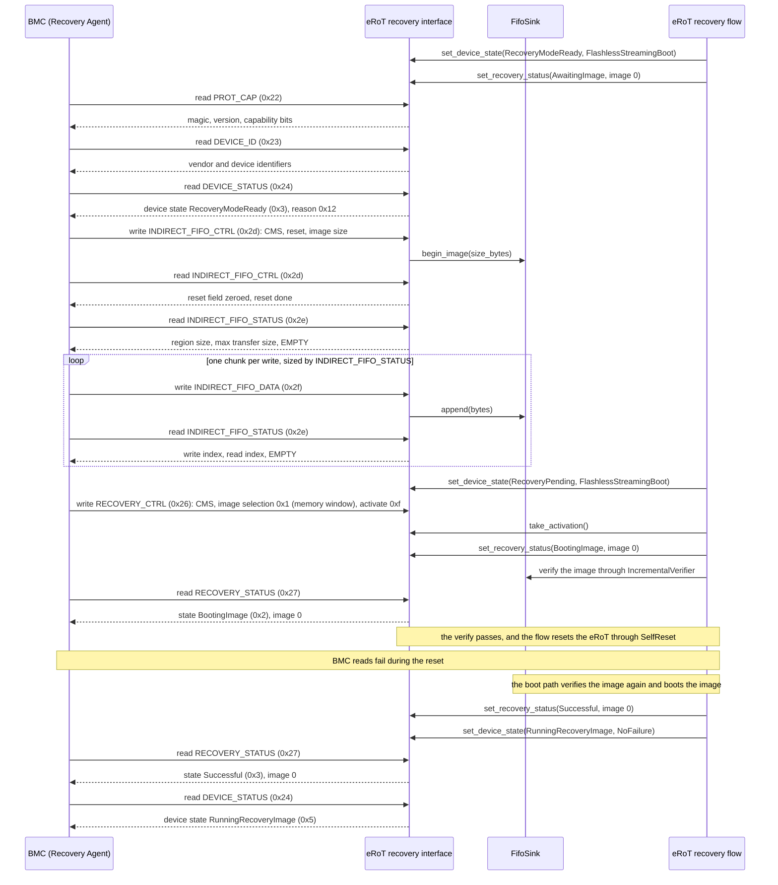
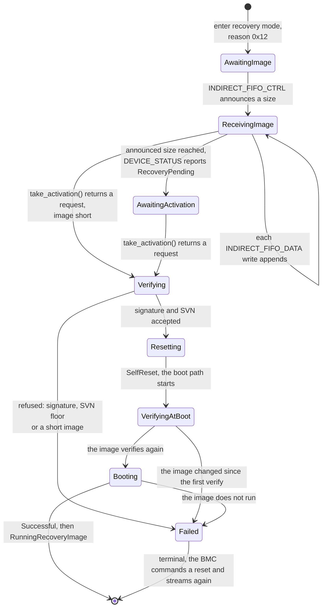
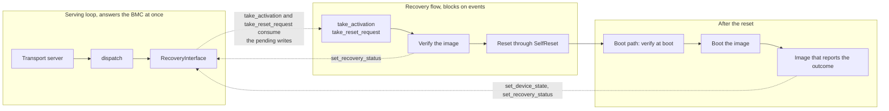

# OCP Recovery Streaming Boot

The eRoT serves the OCP Recovery interface as the Device, and the BMC
drives it as the Recovery Agent. The Recovery Agent pushes the bytes
and requests the activation, and the Device verifies the image and boots
or refuses it.
[OCP Recovery: the eRoT as Recovery Agent](./ocp-recovery-agent.md)
describes the second role, where the eRoT is the Recovery Agent for a
downstream device.

The boot selector in the eRoT walks a ladder of boot sources: the
active slot with its retries, the other slots, a golden copy where the
board declares one, then the image the BMC streams. Which rungs exist,
and their order, is per-board configuration. Below the ladder, a person
at the board can set the hardware strap, which the chip samples at
power-on, before the boot selector runs, to pick another boot source.
The `Recovery` capability is a separate mechanism: the orchestrator
drives the `Recovery` capability to recover managed devices, and the
eRoT is not a managed device.

The transport binding is out of scope here. Which transports fit is an
open question below. This design covers the device layer below any
transport, so the serving function `dispatch` in
`services/ocp-recovery/server` takes a command byte and a payload and
leaves the framing to the transport server.

## The wire layer

`services/ocp-recovery/api` holds the wire layer: the command byte
values `0x22` through `0x2f`, the access rule, the accepted length and
the scope for each one, and a packed layout per register.
`apply_agent_write` validates every byte of a write before storing any,
so when `apply_agent_write` refuses a write, the target register keeps
the bytes it held. The crate defines `OCP RECV` as the `PROT_CAP` magic
and version 1.1, which the Device advertises. Every value in this
document follows OCP Secure Firmware Recovery 1.1.

`services/ocp-recovery/server` holds the registers and the dispatch
function. `RecoveryInterface` holds the single copy of the register
state, `dispatch` serves one Recovery Agent read or write against it, and
`FifoSink` is the seam the streamed bytes leave through. A `FifoSink`
that also implements `ByteSource` from `util/io` lets the verifier read
the image back, and the verifier already reads through `ByteSource`, so
the verify step needs no adapter.

`services/ocp-recovery/tests/agent_sequence_host.rs` drives the wire
side from the Recovery Agent against `RecoveryInterface` and pins the
register semantics the diagrams below describe. The test writes the
status registers itself, standing in for the verifier and the boot, and
keeps one `RecoveryInterface` throughout, with no reset.

## The streaming-boot sequence

The Device answers commands on this interface and raises no interrupt,
so the Recovery Agent finds out that the eRoT entered recovery mode by
polling: `DEVICE_STATUS` answers `RecoveryModeReady` with the reason,
and the heartbeat field advances while the Device runs, so the agent
sees whether a Device that reports the same status is still waiting for
bytes or has stopped. A board that serves the interface declares its
heartbeat period in `PROT_CAP` byte 14, and the value has to be
non-zero, because 0 is the spec value for a Device that sends no
heartbeat. When the BMC starts polling, how often it polls and how many
times it streams again are BMC policy, outside this design.

The serving loop and the main flow of the firmware that serves the
registers run as separate execution contexts. The interface and the
`FifoSink` are objects the serving loop writes inside each `dispatch`
call, so every arrow the BMC starts is work the serving loop does, the
`begin_image` and `append` calls into the `FifoSink` included. The arrows
the recovery flow starts run in the main flow, which blocks on
`take_activation` while the serving loop keeps answering the BMC. The
BMC polls, so a read that lands before a recovery-flow update returns
the older value, and the diagram shows the poll that lands after.

After the reset, the "eRoT recovery flow" and "eRoT recovery interface"
lifelines stand for the image that reports the outcome. Which image
reports the outcome is an open question.

The agent-sequence host test (`agent_sequence_host.rs`) drives the agent
half of this sequence, plus the error and heartbeat polls the diagram
leaves out. It streams an image in chunks the size the FIFO advertises,
checks the write and read indices after every chunk, and ends on the
same terminal reads of `RECOVERY_STATUS` and `DEVICE_STATUS`, with the
status writes the flow will make standing in for the flow.

The agent paces the push by reading `INDIRECT_FIFO_STATUS` after every
chunk and watching the EMPTY bit. The spec also lets an agent pace on a
NACK, or on the gap between the write index and the read index, and an
agent that keeps inside the max transfer size may push without reading
at all. The `dispatch` call copies each chunk into the `FifoSink` while
it handles the `INDIRECT_FIFO_DATA` write that carried it, so the FIFO
reads empty with both indices equal after every push and no second
consumer has to run first.

`INDIRECT_FIFO_CTRL` and `INDIRECT_FIFO_STATUS` count 4-byte units, so
the image size, the region size, the max transfer size and both indices
are 4-byte counts on the wire and the server converts them to bytes.

The announced size bounds the push. `begin_image` refuses a size larger
than the `FifoSink` holds, and `dispatch` refuses the whole of a write
that would carry the received bytes past the announced size: the
`FifoSink` keeps the bytes it holds, the indices do not move, and
`dispatch` latches a protocol error the next `DEVICE_STATUS` read
returns. An agent that overran writes `INDIRECT_FIFO_CTRL` again with
the reset field set, which discards the received image and announces
the new size.

## Verifying the streamed image

The Device treats the transport as unauthenticated. I3C, for example,
authenticates neither side, so the Device cannot tell whether the bytes
it received came from the BMC. The Device verifies the image after the
push, executes only bytes that a verify covered, and keeps unverified
bytes out of executable memory.

The verify step runs through `IncrementalVerifier`. The flow starts a
session and polls it over the image as a `ByteSource`, and an
`Authenticated` outcome carries the `AuthenticatedImage` that reports
the SVN. The flow compares that SVN against the SVN floor of the eRoT,
which `ErotUpdate` names as `SvnFloor`, not against the SVN floor the
orchestrator reads for a managed device.

Both answers to the open question "Where does the `FifoSink` put the
streamed image?" share one order, which the diagrams draw: the flow
verifies the image, resets the eRoT through `SelfReset`, and the boot
path verifies the image again before booting the image. Memory can
change after the verify before the reset, by an attack or by accident,
so the verify at boot covers the bytes the boot runs. Caliptra boots the
verified image without a reset and keeps no copy of the image across a
reset.

If the streamed image fails after it boots, the BMC commands a reset
over `DEVICE_RESET` and streams again. The flow takes that command with
`take_reset_request` and performs the reset through `SelfReset`, the
capability that already resets the eRoT when an eRoT update activates.

Proposed mapping from the verify outcome to `RECOVERY_STATUS` and
`DEVICE_STATUS`; the spec leaves the reason code to the Device, so the
mapping is open to review:

| Verify outcome | RECOVERY_STATUS state | DEVICE_STATUS state and reason |
| --- | --- | --- |
| Image passes the verify before the reset and the verify at boot, and boots | `Successful` (0x3) | `RunningRecoveryImage` (0x5), no reason code |
| Signature does not verify | `AuthenticationError` (0xd) | `BootFailure` (0xe), `RecoveryFirmwareAuthFailure` (0xf) |
| The verify at boot refuses the image | `AuthenticationError` (0xd) | `BootFailure` (0xe), `RecoveryFirmwareAuthFailure` (0xf) |
| Image SVN below the SVN floor | `Failed` (0xc) | `BootFailure` (0xe), `RecoveryFirmwareRollback` (0x10) |
| Image malformed or short | `Failed` (0xc) | `BootFailure` (0xe), `RecoveryFirmwareMissing` (0xe) |
| Device cannot enter recovery | `EnterRecoveryError` (0xe) | `BootFailure` (0xe), `GenericHardwareError` (0x1) |

Only `RecoveryModeReady`, `RecoveryPending` and `BootFailure` carry a
reason code, and the interface stores 0 for every other state. The last
row reports the failure through `BootFailure` rather than `FatalError`.
The spec calls a fatal error not recoverable through the OCP flow and
populates no reason code for it, so a Recovery Agent reading `FatalError`
stops pushing images, while `BootFailure` carries the reason code that
says what to fix.

The image that reports the outcome after the reset writes the values of
the `Successful` row and of the row for the verify at boot.

The Recovery Agent clears a terminal state with the `DEVICE_RESET`
command, and the eRoT takes the request through `take_reset_request` and
resets itself. `RECOVERY_STATUS` is read-only on the wire, so only the
Device writes `RECOVERY_STATUS`.

## The execution model

On a platform where firmware serves the registers, the operational
image runs the recovery sequence as its main flow, in place of a
separate recovery service or an event-driven state machine. The flow
runs straight through to the verify before the reset and blocks on
`take_activation` and `take_reset_request`, while the transport loop
underneath keeps serving `dispatch`. After the reset, the boot path runs
the verify at boot and boots the image, and the image that reports the
outcome writes the status registers.

`RECOVERY_STATUS` names none of `Verifying`, `Resetting`,
`VerifyingAtBoot` and `Booting`. The recovery flow runs `Verifying` and
`Resetting`, and the boot path runs `VerifyingAtBoot` and `Booting`. The
flow writes `BootingImage` (0x2) when `take_activation` returns the
request, so a BMC that polls during the verify before the reset reads
`BootingImage`. BMC reads fail during the reset, and after the reset the
image that reports the outcome writes `Successful` or the failure.

The wire half and the policy half are split, so the recovery flow can
block without stalling the BMC:

The BMC polls `DEVICE_STATUS` and `INDIRECT_FIFO_STATUS` and watches the
heartbeat for as long as the flow runs, so the wire half must not block
on the policy half. Caliptra can spin on the same registers in a
blocking loop because hardware serves them: the I3C core answers the
BMC whatever the firmware does. On the eRoT the firmware is what
answers, so the recovery flow cannot spin. It blocks on events while the
serving loop keeps answering, and `tick_heartbeat` shows the BMC that
the Device is alive.

Caliptra behaviours that follow from its silicon do not carry over: the
DMA shim that moves FIFO bytes, the read from a fixed FIFO address, the
dummy mailbox lock, and hashing over AXI. `RecoveryInterface` is
firmware state, so the `FifoSink` receives the bytes inside the
`dispatch` call that handles the `INDIRECT_FIFO_DATA` write.

Until a streamed image verifies and boots, the image serving the
interface only serves the interface and holds every downstream device in
reset through `BootControl::hold_in_reset`.

## Which image serves the interface

On a platform where firmware serves the registers, the operational image
serves the interface, and enters a degraded OCP mode on fatal paths the
firmware detects, such as a failed bring-up. Serving the interface after
a fatal error is best effort, because the firmware state may be
corrupt. On Caliptra the I3C core serves the registers in hardware and
Caliptra firmware runs the recovery flow.

Whether a board serves OCP streaming at all is board configuration in
the board target, which a const function checks at build time. The
build derives the `PROT_CAP` capability bits and the FIFO region size
from that configuration, and a board that declares nothing builds no
serving flow.

## The scope rule and the protocol-error latch

Each command belongs to a group, and the group sets the states in which
`dispatch` serves the command. Commands `0x22` through `0x27`, which are
`PROT_CAP`, `DEVICE_ID`, `DEVICE_STATUS`, `DEVICE_RESET`,
`RECOVERY_CTRL` and `RECOVERY_STATUS`, are always available, and so is
`HW_STATUS` (`0x28`) on a board that advertises `PROT_CAP` bit 9.
`HW_STATUS` carries the composite temperature and the hardware error
bits, which a BMC reads while the eRoT runs normally, so recovery mode
does not gate it. The indirect memory window (`0x29` to `0x2b`) and the
vendor command (`0x2c`) are unsupported in every state, and `dispatch`
answers them with the unsupported-command error.

That leaves the FIFO group (`0x2d` to `0x2f`) as the one scoped group.
It is available while `DEVICE_STATUS` byte 0 reads `RecoveryModeReady`
(0x3) or `RecoveryPending` (0x4), and only when `PROT_CAP` bit 12, FIFO
CMS support, is set. `dispatch` refuses the FIFO group in every other
state, `Healthy` (0x1) and `RunningRecoveryImage` (0x5) included: the first means the Device runs
outside recovery mode, and the second means the streamed image already
runs and the FIFO holds nothing the agent can use.

`dispatch` latches a protocol error for each refused FIFO command. The
spec requires an error only on an unsupported command, so this refusal
is stricter. Outside recovery the FIFO
registers carry no image size, no indices and no staged bytes, and an
agent that reads them learns nothing.

`BootFailure` (0xe) is neither `RecoveryModeReady` nor
`RecoveryPending`, so `dispatch` refuses the FIFO commands after the
verify refuses an image, and the agent commands `DEVICE_RESET` before it
announces a new size. The eRoT resets, re-enters recovery mode with an
empty `FifoSink` and writes `RecoveryModeReady`, and the agent streams
the corrected image from there.

The `dispatch` change that enforces the rule also changes the wire
layer. No predicate in `services/ocp-recovery/api` names
`RecoveryModeReady` and `RecoveryPending` together, so the enforcing
change takes the pair from this page, and `RecoveryCommand::scope` puts
`HW_STATUS` in `RecoveryMode` today, which the enforcing change moves to
`Always`.

A refusal changes no register except the error byte it latches.
`dispatch` validates access, length and every byte of the payload before
storing anything, latches a protocol error into `DEVICE_STATUS` byte 1,
and answers zero bytes. The latch clears when the Recovery Agent reads
`DEVICE_STATUS`, and the read returns the error that was latched before
the clear. A second error arriving before that read overwrites the first,
so the Recovery Agent sees the most recent one.

The protocol error values are the `ProtocolError` bytes in
`services/ocp-recovery/api`.

"Write 1, Device Clears" works on the whole field: the Device writes
the idle value back once it has acted, and it refuses a write of any
value the field does not name. The values differ per field.
`RECOVERY_CTRL` byte 2 takes `0xf` to activate and `0x0` for idle,
`INDIRECT_FIFO_CTRL` byte 1 takes `0x1` to reset the indices and `0x0`
for idle, and `DEVICE_RESET` byte 0 takes `0x1` for a device reset and
`0x2` for a management reset.

## Out of scope

Forced recovery is out of scope. Caliptra does not implement it, and
adopting it later costs a configuration field plus the operational image
serving the registers. The interface decodes the forced-recovery value
the agent writes and keeps it across the reset take, so adopting forced
recovery later needs no change to the wire layer.

Multi-stage activation is out of scope. The spec has the Device
increment the recovery image index and return to awaiting an image when
a further stage follows a successful activation, so an agent streams one
stage after another. The eRoT accepts one streamed image and boots it,
and the flow reports image 0 throughout. The register file carries the
index field, so adopting stages later costs the flow a counter rather
than a wire change.

Also out of scope: the indirect memory window and the vendor command,
which `dispatch` refuses in every state and `PROT_CAP` does not
advertise, and the transport binding.

Downstream devices are out of scope on this page. The interface the
eRoT serves carries images for the eRoT only.
[OCP Recovery: the eRoT as Recovery Agent](./ocp-recovery-agent.md)
covers the eRoT as Recovery Agent for a downstream device that serves
OCP Recovery.

## Open questions

Where does the `FifoSink` put the streamed image?

- RAM. The RAM answer needs RAM that keeps its contents across a
  reset. The Device writes the image to that RAM, verifies the image,
  resets, and the boot path verifies the image again and boots the
  image from RAM. The boot path also needs a marker that tells it an
  image waits in RAM, and clears the marker before booting the image,
  so a later `DEVICE_RESET` brings the eRoT back to recovery mode
  instead of booting the same image again. The Device writes no flash, the SVN floor keeps the SVN it
  has, and no trial boot runs. The RAM region bounds the image size,
  and a power cycle clears the image.
- Flash. The Device writes the image to a flash slot, verifies the
  image, resets and boots the image through the normal boot path, which
  verifies the image again. The image survives a power cycle, so a trial
  boot and an SVN floor advance on confirm apply as they do for an
  update.

The reset before the boot clears `RecoveryInterface` unless the design
keeps `RecoveryInterface` in RAM that survives the reset, so the design
has to name the image that reports the outcome to the BMC after the
reset. A refusal at the verify at boot needs that report as well.

With flash, a failed trial boot puts the eRoT back in recovery mode,
because the local images failed before the stream. A flash write inside
`dispatch` delays the answer to the `INDIRECT_FIFO_DATA` write for the
length of the flash write. A flash write deferred out of `dispatch`
leaves bytes in the FIFO, so the FIFO no longer reads empty after every
push.

What does the OCP push carry: a full image, or a small first image that
runs PLDM firmware update and loads the rest over PLDM? A small first
image fits a smaller `FifoSink` and moves the bulk of the transfer to
PLDM. The PLDM load uses no OCP image index, so the PLDM load is not
part of the multi-stage activation scope above, which covers OCP stages
only.

Which reason code does the eRoT report on entering recovery? The
sequence diagram and the state diagram report `FlashlessStreamingBoot`
(0x12), which the doc comment in `services/ocp-recovery/api` describes
as a Device that boots with no local image. An eRoT whose local images
failed still holds local images, so which reason fits that eRoT is open.

Must streaming boot cover the case where the operational image does not
run at all, without physical access? Nothing inside that image can
serve the interface when it does not run, so a technician boots the
board from the strap after any of these: the ROM rejects a corrupt
image, an update tears, or every slot sits below the SVN floor.

A yes means a second signed image, a recovery copy in a separate flash
region with a separate composition, which a hardware boot fallback
starts when the operational image does not signal liveness in time. It
costs a second binary to sign, provision and write-protect, a policy for
rewriting a write-protected copy, and the platform capabilities behind
it: a boot fallback the hardware starts before the ROM runs, flash write
protection the hardware locks until a reset, and a ROM anti-rollback
counter, which is not the `SvnFloor` the firmware reads, kept at or
below the revision of the recovery copy. The second image also needs a
decision on what it contains: a full firmware carrying the degraded
mode, a minimal recovery-only image, or a per-board choice.

A no leaves the operational image as the only image that serves the
interface, and a technician handles the cases above at the strap.

Either way, the image that serves the interface is the ROM or an image
the boot path already verified, because the eRoT runs that image before
the BMC sends any bytes.

Smaller questions:

- What update policy governs the recovery copy? Rewriting it means
  lifting the write protection, which is the same capability an attacker
  needs, so the platform decides who may rewrite the recovery copy, with
  what authorization and in what setting. The policy
  also has to keep the ROM anti-rollback counter at or below the
  revision of the recovery copy, or rewrite the recovery copy before
  advancing the counter.
- How does the BMC reset the eRoT when the streamed image that booted
  stops serving the interface? The in-band `DEVICE_RESET` needs a
  `dispatch` that still runs, so this case needs board wiring, either a
  BMC-driven pin that fires the boot fallback or a reset line from the
  BMC to the eRoT. Without that wiring, a technician recovers the eRoT
  through the strap.
- Does the fallback watchdog keep counting on the ROM failure path, so
  the hardware boot fallback starts the recovery copy after the ROM
  refuses the operational image? A bench test on each board answers the
  question.
- Where does streaming boot sit in the ladder? This design puts it under
  every local rung and above the strap, which suits a board whose local
  images are all exhausted before the BMC pushes bytes to the eRoT. A
  board that trusts the BMC more than a stale golden copy would order
  them the other way, and the order is per-board configuration either
  way. Some platforms put streaming boot at the top of the ladder, as
  the primary boot path.
- Which push mechanism does the eRoT serve? This design serves the FIFO
  (`0x2d` to `0x2f`) and refuses the indirect memory window (`0x29` to
  `0x2b`). The OpenBMC Recovery Agent proposed under the
  `ocp-fw-recovery` topic on gerrit.openbmc.org pushes through the
  memory window over SMBus and refuses a Device that advertises only the
  FIFO, so the OpenBMC Recovery Agent cannot stream to the eRoT as
  designed. Either the eRoT serves the memory window as well, or the
  OpenBMC Recovery Agent adds FIFO support.
- Can firmware answer an I3C block read in time? I3C gives the target
  no way to stall the clock, so a `dispatch` in firmware may miss the
  response window. The alternatives are a hardware I3C target, SMBus or
  USB.
- What maximum boot time must a streamed image meet? The maximum boot
  time decides which transports and image sizes work.
- What retry count and poll timing must the eRoT tolerate? The verify
  before the reset, the reset, the verify at boot and the boot have to
  finish inside the time the BMC keeps polling `RECOVERY_STATUS`. BMC
  reads fail during the reset, and the heartbeat restarts after the
  reset.
- May a platform that has latched `LockdownLatch` serve the interface?
  The latch is one-way and terminal, so a streamed image that runs
  afterwards undoes the safe state the latch put the platform in. Either
  the degraded mode stays out of the latched path, or the
  `LockdownLatch` contract states an exception for serving the
  interface.
- Forced recovery stays out of scope unless review raises it.
