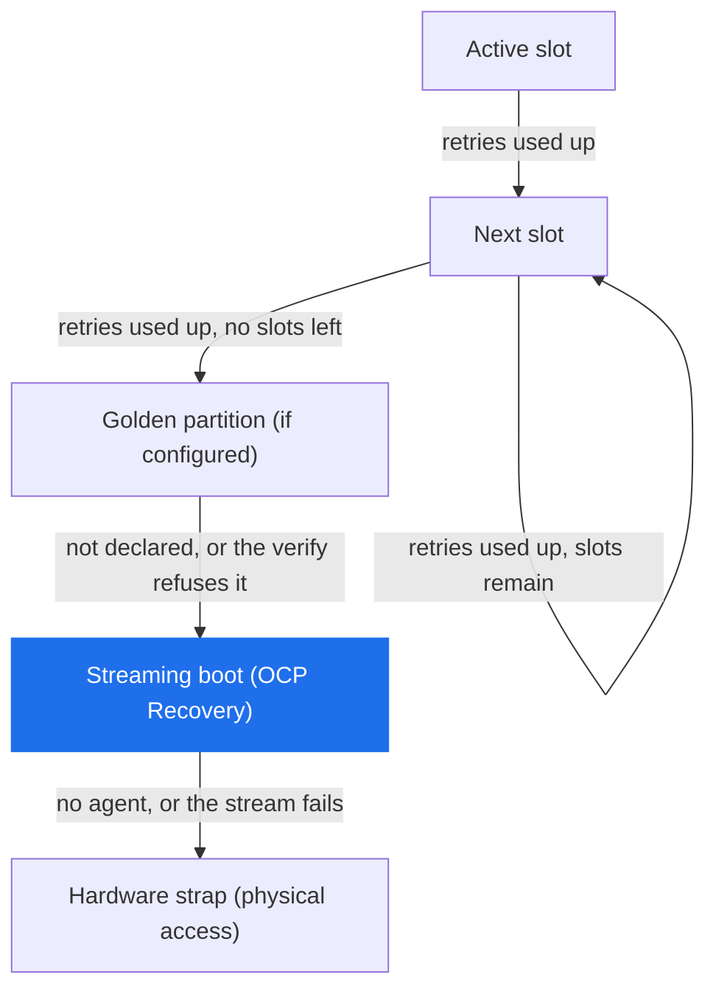
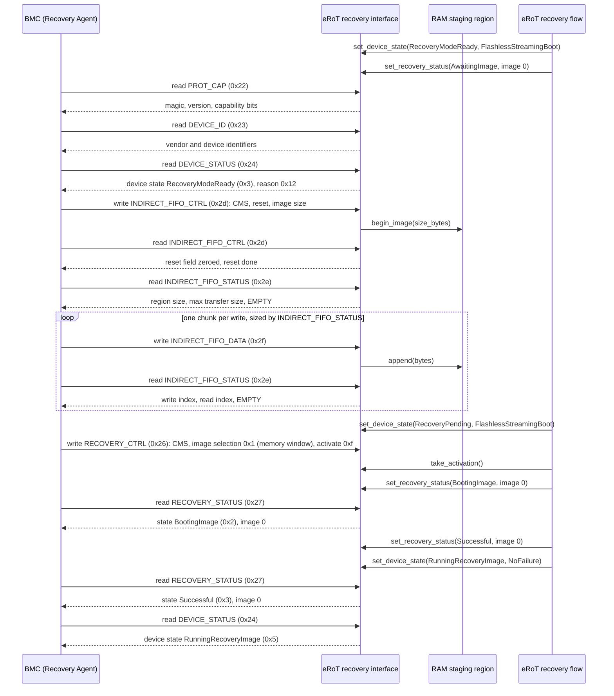
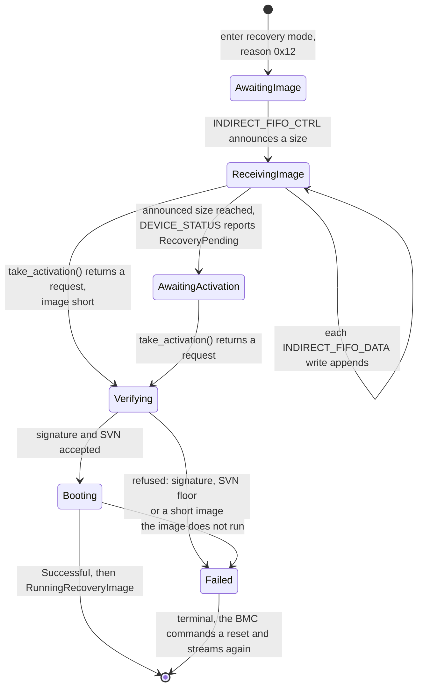
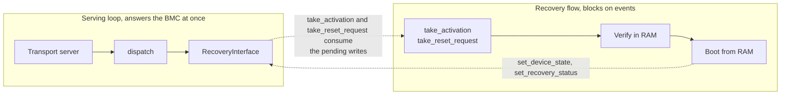

# OCP Recovery Streaming Boot

The eRoT serves the OCP Recovery interface as the Device, and the BMC
drives it as the Recovery Agent. The Recovery Agent pushes the bytes
and requests the activation, and the Device verifies the image and boots
or refuses it.

Streaming boot sits below every local image option on the board. The
eRoT tries the active slot with its retries, then whatever local rungs
the board declares, and once the local options are gone, accepts an
image that the BMC streams. The boot selector in the eRoT walks these
rungs. The `Recovery` capability is a separate mechanism: the
orchestrator drives the `Recovery` capability to recover managed
devices, and the eRoT is not a managed device. Which rungs exist is
per-board configuration rather than a rule this design fixes, and the
image layout schema permits a golden copy.

The strap stays the bottom rung. The chip samples a pin at power-on and
the ROM boots from a source other than the normal flash image. Which pin
and which source are per-chip, and a strap boot needs a person with
physical access to the board.

The transport binding is out of scope here, with I3C and USB the
primary interfaces. This design covers the device layer below any of
them, so the serving function `dispatch` in
`services/ocp-recovery/server` takes a command byte and a payload and
leaves the framing to the transport server.

## The wire layer

`services/ocp-recovery/api` holds the wire layer: the command byte
values `0x22` through `0x2f`, the access rule, the accepted length and
the scope for each one, and a packed layout per register.
`apply_agent_write` validates every byte of a write before storing any,
so when `apply_agent_write` refuses a write, the target register keeps
the bytes it held. The crate defines `OCP RECV` as the `PROT_CAP` magic
and version 1.1, which the Device advertises. Every value in this
document follows OCP Secure Firmware Recovery 1.1.

`services/ocp-recovery/server` holds the registers and the dispatch
function. `RecoveryInterface` holds the single copy of the register
state, `dispatch` serves one Recovery Agent read or write against it, and
`FifoSink` is the seam the streamed bytes leave through. `RamStaging<N>`
implements the seam over a fixed buffer and implements `ByteSource` from
`util/io` for the read side. The verifier and the board staging region
already read through `ByteSource`, so a staged image needs no adapter.

`services/ocp-recovery/tests/agent_sequence_host.rs` drives the wire
side from the Recovery Agent against `RecoveryInterface` and pins the
register semantics the diagrams below describe. The test writes the
status registers itself, standing in for the verifier and the boot.

## The streaming-boot sequence

The Device answers commands on this interface and raises no interrupt,
so the Recovery Agent finds out that the eRoT entered recovery mode by
polling: `DEVICE_STATUS` answers `RecoveryModeReady` with the reason,
and the heartbeat field advances while the Device runs, so the agent
sees whether a Device that reports the same status is still waiting for
bytes or has stopped. A board that serves the interface declares its
heartbeat period in `PROT_CAP` byte 14, and the value has to be
non-zero, because 0 is the spec value for a Device that sends no
heartbeat. When the BMC starts polling is platform policy, outside this
design.

The serving loop and the main flow of the firmware that serves the
registers run as separate execution contexts. The interface and the RAM
staging are objects the serving loop writes inside each `dispatch` call,
so every arrow the BMC starts is work the serving loop does, the
`begin_image` and `append` calls into the staging included. The arrows
the recovery flow starts run in the main flow, which blocks on
`take_activation` while the serving loop keeps answering the BMC. The
BMC polls, so a read that lands before a recovery-flow update returns
the older value, and the diagram shows the poll that lands after.

The agent-sequence host test (`agent_sequence_host.rs`) drives the agent
half of this sequence, plus the error and heartbeat polls the diagram
leaves out. It streams an image in chunks the size the FIFO advertises,
checks the write and read indices after every chunk, and ends on the
same terminal reads of `RECOVERY_STATUS` and `DEVICE_STATUS`, with the
status writes the flow will make standing in for the flow.

The agent paces the push by reading `INDIRECT_FIFO_STATUS` after every
chunk and watching the EMPTY bit. The spec also lets an agent pace on a
NACK, or on the gap between the write index and the read index, and an
agent that keeps inside the max transfer size may push without reading
at all. The `dispatch` call copies each chunk into staging while it
handles the `INDIRECT_FIFO_DATA` write that carried it, so the FIFO
reads empty with both indices equal after every push and no second
consumer has to run first.

`INDIRECT_FIFO_CTRL` and `INDIRECT_FIFO_STATUS` count 4-byte units, so
the image size, the region size, the max transfer size and both indices
are 4-byte counts on the wire and the server converts them to bytes.

The announced size bounds the push. `begin_image` refuses a size larger
than the staging region, and a write that would carry the staged bytes
past the announced size is refused whole: the staging keeps the bytes it
holds, the indices do not move, and `dispatch` latches a protocol error
the next `DEVICE_STATUS` read returns. An agent that overran writes
`INDIRECT_FIFO_CTRL` again with the reset field set, which discards the
staged image and announces the new size.

## What happens to the streamed image

The eRoT verifies the streamed image in RAM and boots it from RAM. This
design starts from the Caliptra implementation of streaming boot, which
verifies the streamed image in SRAM and boots it without persisting it.

Writing a fresh image into a redundant partition is a flash install. The
recovery flow writes no flash, so a flash install stays out of scope.
Booting an image that already sits in a redundant or golden partition
writes nothing, so that boot stays in scope. A boot from a redundant or
golden partition is a local rung of the ladder above, and the boot
selector takes it without the BMC.

The eRoT writes nothing to flash and runs no trial boot. The recovery
path reads the SVN floor to judge the image, and the SVN floor keeps the
SVN it has, because a recovery boot is not an installation. If the
streamed image fails after it boots, the BMC commands a reset over
`DEVICE_RESET` and streams again, because a RAM image has no slot to
revert to. The flow takes that command with `take_reset_request` and
performs it through `SelfReset`, the capability that already resets the
eRoT when an eRoT update activates. No trial boot runs, so
`DeviceTrialBoot` stays out of this path. A trial record judges an
installed image, and the recovery flow installs none.

The verify step runs through `IncrementalVerifier`. The flow starts a
session and polls it over the staged bytes as a `ByteSource`, and an
`Authenticated` outcome carries the `AuthenticatedImage` that reports
the SVN. The flow compares that SVN against the SVN floor of the eRoT,
which `ErotUpdate` names as `SvnFloor`, not against the SVN floor the
orchestrator reads for a managed device. The flow calls `floor` and
never `advance`.

Proposed mapping from the verify outcome to `RECOVERY_STATUS` and
`DEVICE_STATUS`; the spec leaves the reason code to the Device, so the
mapping is open to review:

| Verify outcome | RECOVERY_STATUS state | DEVICE_STATUS state and reason |
| --- | --- | --- |
| Image authenticates and boots | `Successful` (0x3) | `RunningRecoveryImage` (0x5), no reason code |
| Signature does not verify | `AuthenticationError` (0xd) | `BootFailure` (0xe), `RecoveryFirmwareAuthFailure` (0xf) |
| Image SVN below the SVN floor | `Failed` (0xc) | `BootFailure` (0xe), `RecoveryFirmwareRollback` (0x10) |
| Image malformed or short | `Failed` (0xc) | `BootFailure` (0xe), `RecoveryFirmwareMissing` (0xe) |
| Device cannot enter recovery | `EnterRecoveryError` (0xe) | `BootFailure` (0xe), `GenericHardwareError` (0x1) |

Only `RecoveryModeReady`, `RecoveryPending` and `BootFailure` carry a
reason code, and the interface stores 0 for every other state. The last
row reports the failure through `BootFailure` rather than `FatalError`.
The spec calls a fatal error not recoverable through the OCP flow and
populates no reason code for it, so a Recovery Agent reading `FatalError`
stops pushing images, while `BootFailure` carries the reason code that
says what to fix.

The Recovery Agent clears a terminal state with the `DEVICE_RESET`
command, and the eRoT takes the request through `take_reset_request` and
resets itself. `RECOVERY_STATUS` is read-only on the wire, so only the
Device writes `RECOVERY_STATUS`.

## The execution model

The operational image runs the recovery sequence as its main flow, in
place of a separate recovery service or an event-driven state machine.
The flow runs straight through and blocks on `take_activation` and
`take_reset_request`, while the transport loop underneath keeps serving
`dispatch`.

`Verifying` and `Booting` are flow states, and `RECOVERY_STATUS` names
neither. The flow writes `BootingImage` (0x2) when `take_activation`
returns the request and keeps it until the image boots or the verify
refuses it, so a BMC that polls during the verify reads `BootingImage`.

The wire half and the policy half are split, so the recovery flow can
block without stalling the BMC:

The BMC polls `DEVICE_STATUS` and `INDIRECT_FIFO_STATUS` and watches the
heartbeat for as long as the flow runs, so the wire half must not block
on the policy half. Caliptra can spin on the same registers in a
blocking loop because hardware serves them: the I3C core answers the
BMC whatever the firmware does. On the eRoT the firmware is what
answers, so the recovery flow cannot spin. It blocks on events while the
serving loop keeps answering, and `tick_heartbeat` shows the BMC that
the Device is alive.

Caliptra behaviours that follow from its silicon do not carry over: the
DMA shim that moves FIFO bytes, the read from a fixed FIFO address, the
dummy mailbox lock, and hashing over AXI. `RecoveryInterface` is
firmware state, so the staging receives the bytes inside the `dispatch`
call that handles the `INDIRECT_FIFO_DATA` write.

Until a streamed image verifies and boots, the image serving the
interface only serves the interface and holds every downstream device in
reset through `BootControl::hold_in_reset`.

## Which image serves the interface

The operational image serves the interface. It carries a degraded OCP
mode that it enters on fatal paths the firmware itself detects, such as
a failed bring-up, and serving the interface after a fatal error is best
effort from possibly corrupted state.

Whether a board serves OCP streaming at all is board configuration,
declared in the board target next to the device table and checked by a
const function at build time. The `PROT_CAP` capability bits, the FIFO
region size and whether an image enters the serving flow all derive from
that declaration at compile time, so a board that declares nothing
builds no serving flow, and the build fixes the capability bits before
the image runs.

This design does not serve the interface from the ROM, because the ROM
is fixed silicon and takes no firmware this project builds. Whether a
second image serves the interface as well is the open question below.

## The scope rule and the protocol-error latch

Each command belongs to a group, and the group sets the states in which
`dispatch` serves the command. Commands `0x22` through `0x27`, which are
`PROT_CAP`, `DEVICE_ID`, `DEVICE_STATUS`, `DEVICE_RESET`,
`RECOVERY_CTRL` and `RECOVERY_STATUS`, are always available, and so is
`HW_STATUS` (`0x28`) on a board that advertises `PROT_CAP` bit 9.
`HW_STATUS` carries the composite temperature and the hardware error
bits, which a BMC reads while the eRoT runs normally, so recovery mode
does not gate it. The indirect memory window (`0x29` to `0x2b`) and the
vendor command (`0x2c`) are unsupported in every state, and `dispatch`
answers them with the unsupported-command error.

That leaves the FIFO group (`0x2d` to `0x2f`) as the one scoped group.
It is available while `DEVICE_STATUS` byte 0 reads `RecoveryModeReady`
(0x3) or `RecoveryPending` (0x4), and only when `PROT_CAP` bit 12, FIFO
CMS support, is set. `dispatch` refuses the FIFO group in every other
state, `Healthy` (0x1) and `RunningRecoveryImage` (0x5) included: the first means the Device runs
outside recovery mode, and the second means the streamed image already
runs and the FIFO holds nothing the agent can use.

`dispatch` latches a protocol error for each refused FIFO command. The
spec requires an error only on an unsupported command, so this refusal
is stricter. Outside recovery the FIFO
registers carry no image size, no indices and no staged bytes, and an
agent that reads them learns nothing.

`BootFailure` (0xe) is neither `RecoveryModeReady` nor
`RecoveryPending`, so `dispatch` refuses the FIFO commands after the
verify refuses an image, and the agent commands `DEVICE_RESET` before it
announces a new size. The eRoT resets, re-enters recovery mode with an
empty staging and writes `RecoveryModeReady`, and the agent streams the
corrected image from there.

The `dispatch` change that enforces the rule also changes the wire
layer. No predicate in `services/ocp-recovery/api` names
`RecoveryModeReady` and `RecoveryPending` together, so the enforcing
change takes the pair from this page, and `RecoveryCommand::scope` puts
`HW_STATUS` in `RecoveryMode` today, which the enforcing change moves to
`Always`.

A refusal changes no register except the error byte it latches.
`dispatch` validates access, length and every byte of the payload before
storing anything, latches a protocol error into `DEVICE_STATUS` byte 1,
and answers zero bytes. The latch clears when the Recovery Agent reads
`DEVICE_STATUS`, and the read returns the error that was latched before
the clear. A second error arriving before that read overwrites the first,
so the Recovery Agent sees the most recent one.

The protocol error values are the `ProtocolError` bytes in
`services/ocp-recovery/api`.

"Write 1, Device Clears" works on the whole field: the Device writes
the idle value back once it has acted, and it refuses a write of any
value the field does not name. The values differ per field.
`RECOVERY_CTRL` byte 2 takes `0xf` to activate and `0x0` for idle,
`INDIRECT_FIFO_CTRL` byte 1 takes `0x1` to reset the indices and `0x0`
for idle, and `DEVICE_RESET` byte 0 takes `0x1` for a device reset and
`0x2` for a management reset.

## Out of scope

Forced recovery is out of scope. Caliptra does not implement it, and
adopting it later costs a configuration field plus the operational image
serving the registers. The interface decodes the forced-recovery value
the agent writes and keeps it across the reset take, so adopting forced
recovery later needs no change to the wire layer.

Multi-stage activation is out of scope. The spec has the Device
increment the recovery image index and return to awaiting an image when
a further stage follows a successful activation, so an agent streams one
stage after another. The eRoT accepts one streamed image and boots it,
and the flow reports image 0 throughout. The register file carries the
index field, so adopting stages later costs the flow a counter rather
than a wire change.

Also out of scope: the indirect memory window and the vendor command,
which `dispatch` refuses in every state and `PROT_CAP` does not
advertise, and the transport binding.

Downstream devices are out of scope. The interface carries images for
the eRoT only.

## Open questions

Must streaming boot cover the case where the operational image does not
run at all, without physical access? Nothing inside that image can
serve the interface when it does not run, so a technician boots the
board from the strap after any of these: the ROM rejects a corrupt
image, an update tears, or every slot sits below the SVN floor.

A yes means a second signed image, a recovery copy in a separate flash
region with a separate composition, which a hardware boot fallback
starts when the operational image does not signal liveness in time. It
costs a second binary to sign, provision and write-protect, a policy for
rewriting a write-protected copy, and the platform capabilities behind
it: a boot fallback the hardware starts before the ROM runs, flash write
protection the hardware locks until a reset, and a ROM anti-rollback
counter, which is not the `SvnFloor` the firmware reads, kept at or
below the revision of the recovery copy. The second image also needs a
decision on what it contains: a full firmware carrying the degraded
mode, a minimal recovery-only image, or a per-board choice.

A no leaves the operational image as the only image that serves the
interface, and a technician handles the cases above at the strap.

Smaller questions:

- What update policy governs the recovery copy? Rewriting it means
  lifting the write protection, which is the same capability an attacker
  needs, so the platform decides who may rewrite the recovery copy, with
  what authorization and in what setting. The policy
  also has to keep the ROM anti-rollback counter at or below the
  revision of the recovery copy, or rewrite the recovery copy before
  advancing the counter.
- How does the BMC reset the eRoT when the streamed image that booted
  stops serving the interface? The in-band `DEVICE_RESET` needs a
  `dispatch` that still runs, so this case needs board wiring, either a
  BMC-driven pin that fires the boot fallback or a reset line from the
  BMC to the eRoT. Without that wiring, a technician recovers the eRoT
  through the strap.
- Does the fallback watchdog keep counting on the ROM failure path, so
  the hardware boot fallback starts the recovery copy after the ROM
  refuses the operational image? A bench test on each board answers the
  question.
- Where does streaming boot sit in the ladder? The diagram puts it under
  every local rung and above the strap, which suits a board whose local
  images are all exhausted before the BMC pushes bytes to the eRoT. A
  board that trusts the BMC more than a stale golden copy would order
  them the other way, and the order is per-board configuration either
  way.
- May a platform that has latched `LockdownLatch` serve the interface?
  The latch is one-way and terminal, so a streamed image that runs
  afterwards undoes the safe state the latch put the platform in. Either
  the degraded mode stays out of the latched path, or the
  `LockdownLatch` contract states an exception for serving the
  interface.
- Forced recovery stays out of scope unless review raises it.
