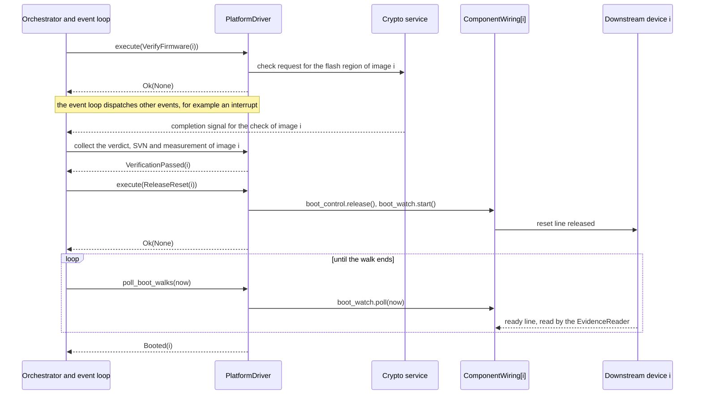

# Platform Driver and Board

The [state machine](./orchestrator-machine.md) emits effects and the
`PlatformDriver` executes each effect. On this page, platform means the
`Platform` trait, the `PlatformDriver` that implements the trait in the
orchestrator process, and the services the `PlatformDriver` calls. This page
describes how the `PlatformDriver` executes each effect, and what a board
supplies so that the `PlatformDriver` can act on real hardware. The
Verification Model describes the split between the state machine and the
platform in
[The Platform Boundary](./orchestrator-model.md#6-the-platform-boundary), and
[Platform Architecture](./orchestrator-platform.md) describes the services
around the orchestrator process.

A board, on this page, is the crate that binds the capability traits to the
hardware of one [product](../../architecture.md#terminology). The
`PlatformDriver` names no chip and no pin.

## One effect, from trigger to hardware

The diagram follows the boot of a passive downstream device `i`, from the
check of the image of `i` to the end of the boot walk.

The `Orchestrator` calls `Platform::execute` for each effect it passes to the
platform. `execute` returns `Ok(None)` once the `PlatformDriver` has made the
capability call, and `Err(EffectError)` when a capability call failed. The
[State Machine](./orchestrator-machine.md) page describes what the state
machine does with each event and with `EffectError`.

An image check or a restore does not hold the event loop. `VerifyFirmware`
sends the check request to the crypto service and `RecoverComponent` starts a
restore, and `execute` returns for both before the result exists. The
`PlatformDriver` hands the result to the event loop later as an event:
`VerificationPassed` or `VerificationFailed`, `Restored` or
`RecoveryUnavailable`. `ReadFirmware` does no work in the `PlatformDriver`,
because the crypto service reads the image from flash when the crypto service
handles the check request of `VerifyFirmware`.

After a release the event loop calls `poll_boot_walks` and dispatches the
events `poll_boot_walks` returns: `ComponentReady` for an active component,
`Booted` for a passive component, and `BootFailed` when a walk times out or
fails. `BootWatch::start` begins a fresh attempt on every release and takes no
timestamp, so the window of the first checkpoint begins at the first `poll`.

## Image checks

The crypto service, a separate task, checks every image. The `PlatformDriver`
sends the flash region of the image and the crypto service reads the flash, so
no image byte passes through the orchestrator. The crypto service answers
authentic or rejected, with the SVN from the signed header and the measurement
of the image, and the `PlatformDriver` sends the measurement to the
`ReportSink` as `Report::Measured`. For a component whose SVN floor the eRoT
keeps, the `PlatformDriver` compares the SVN with `SvnFloor::floor` and hands
the event loop `VerificationFailed` for an SVN below the SVN floor. The
comparison skips the golden image. The golden image sits in a fixed region
that the eRoT never writes. The SVN of the golden image does not change after
the board is built, so once the SVN floor is above that SVN, a comparison would
reject the last image recovery can fall back to.

For a component whose slots the eRoT writes, the `PlatformDriver` sends the
flash region of the slot the component boots next, taken from the
`ImageLayout` of the row. The eRoT records that slot when the eRoT sets the
slot for the next boot. For an image without an SVN, and when the
`SvnFloor::floor` read fails, the `PlatformDriver` hands the event loop
`VerificationFailed`.

The crypto service queues the check requests, with a channel per sender, so the
`PlatformDriver` and the Firmware Device, the PLDM task on the eRoT that answers
the Update Agent, can both send a check while another check runs. When a check
ends, the crypto service raises a completion signal to the sender. The Firmware
Device collects the verdict of a check the Firmware Device sent, and reports
`UpdateVerified` or `UpdateRejected`. For a check the `PlatformDriver` sent, the
completion signal wakes the event loop and the `PlatformDriver` collects the
verdict.

The `PlatformDriver` sets a deadline for each check the `PlatformDriver` sent,
and cancels the check when the deadline passes. For a rejected image and for a
check that ran out of time, the `PlatformDriver` hands the event loop
`VerificationFailed`, so the state machine starts recovery. On
`RecoverComponent` the `PlatformDriver` also cancels the open check of the
component, but hands the event loop no event for that check, because the state
machine has already started the restore.

At boot and after a restore the `PlatformDriver` sends the check request. During
an update the Firmware Device sends the check request for the candidate, after
the `PlatformDriver` has executed `AuthenticateStageUpdate`. After the
activation the `PlatformDriver` checks the activated image of a downstream
device again before the next release of that device.

## What a board supplies

A board crate builds the capability values and calls the `bring_up` function
with the chain, the device table, a `Board` value and the retry cap.
`bring_up` returns the `Orchestrator` and the `PlatformDriver`, both built from
the chain, so the state machine and the `PlatformDriver` hold the same
component list.

The device table is a `static` array of `DeviceConfig<R, P>`, where `R` is the
board enum of reset lines and `P` the board enum of boot probes. Each row names
the reset line, the boot checkpoints (probe and time window), the optional
`ImageLayout` (slots and golden image), and the `ComponentAttrs`. The row index
is the `ComponentId`. A board declares `const CHAIN = chain_of(&DEVICES)`, and
`chain_of` checks the table during the build: the eRoT at index 0 and nowhere
else, each `depends_on` naming an earlier row.

The eRoT row has no reset line and no checkpoints, because the orchestrator
runs on the eRoT and never releases or walks the eRoT. The eRoT row carries an
`ImageLayout`, because a self-update writes the new image into a slot of the
eRoT.

`Board<B, N>` holds a `ComponentWiring` per component and the parts that serve
every component. The `BoardCapabilities` implementation of the board names the
concrete type of each capability in a single place. A `ComponentWiring` keeps
the reset, boot watch, SVN floor, update, trial and recovery parts of one
component in one struct, and names the row of the component in the device
table. The `bring_up` function checks at every boot that each
`ComponentWiring` names the matching row, before the `PlatformDriver` releases
a reset line.

| Effect | What the `PlatformDriver` does | Board part | Ends |
|---|---|---|---|
| `ReadFirmware` | no work, because the crypto service reads the image for `VerifyFirmware` | none | inside `execute` |
| `VerifyFirmware` | sends the check request for the flash region of the image to the crypto service, and sets a deadline for the check | `ImageLayout` of the row, `Board::verifier` | later, as `VerificationPassed` or `VerificationFailed` |
| `ReleaseReset`, `AssertReset` | `BootControl::release` and `BootWatch::start`, `BootControl::hold_in_reset` | `ComponentWiring::boot_control`, `ComponentWiring::boot_watch` | inside `execute` |
| `RecoverComponent` | cancels the open check of the component and starts the restore from the recovery source of the attempt | `ComponentWiring::recovery` | later, as `Restored` or `RecoveryUnavailable` |
| `AuthenticateStageUpdate` | records that the Firmware Device may send the check for the candidate, and tells the Firmware Device (message open, see Gaps) | `ComponentWiring::updatable` | later, as `UpdateVerified` or `UpdateRejected` |
| `ActivateUpdate` for a downstream device, `DiscardStaged` | sends the Firmware Device the order to activate or to drop the candidate | `ComponentWiring::updatable` | open, see Gaps |
| `ActivateUpdate` for the eRoT | `SelfUpdate::prepare`, `SelfUpdate::set_trial_pending`, `SelfReset::reset` | `Board::self_update` | `SelfReset::reset` returns only if the reset failed |
| `ConfirmDeviceTrial`, `RevertDeviceTrial` | `DeviceTrialBoot::confirm`, `DeviceTrialBoot::revert` | `ComponentWiring::trial` | inside `execute` |
| `ConfirmSelfTrial` | `SelfUpdate::confirm` | `Board::self_update` | inside `execute` |
| `CommitSvnFloor` | `SvnFloor::advance` | `ComponentWiring::svn_floor`, or `ErotUpdate::floor` for the eRoT | open, see Gaps |
| `LatchLockdown` | `LockdownLatch::latch` | `Board::lockdown` | inside `execute` |
| `Report*` | `ReportSink::report` | `Board::report_sink` | inside `execute` |

The board sets `ComponentWiring::svn_floor`, an `SvnFloorBinding`, to state who
writes the slots and keeps the SVN floor of the component, whether the
component is active or passive.
`Erot(floor)` means the eRoT writes the slots of the component and keeps the
SVN floor of the component. The `PlatformDriver` compares the SVN at boot. On
`CommitSvnFloor` the `PlatformDriver` first re-syncs the slots, copying the
confirmed image into the slot the component did not boot, and then advances
the SVN floor. `SelfManaged` means the component writes its slots and keeps its
SVN floor, so the eRoT compares no SVN and `CommitSvnFloor` neither re-syncs a
slot nor advances an SVN floor for that component.

A board may wire `()` for a capability whose hardware the board lacks.
`LockdownLatch` has no `()` implementation, so every board names the safe
state that `LockdownLatch::latch` sets.

## Where a capability runs

A capability implementation drives the hardware from the orchestrator process,
as `HalBootControl` does over a GPIO, or sends a request over a kernel channel
to the task that owns the hardware. A short call, for example a reset command
or an SVN floor write, waits for the reply and holds the event loop for at most
the IPC deadline. A long call, an image check or a restore, sends the request
and returns. `AsyncTransaction` in `util/ipc` starts, collects and cancels such
a request on a kernel channel.

The board chooses per capability which task owns the hardware, through the
type the `BoardCapabilities` implementation names. The process layout in
`system.json5` gives each peripheral to the process the board chose.

## Boot and update entry points

1. The board crate builds the capability values and calls the `bring_up`
   function, which returns the `Orchestrator` and the `PlatformDriver`.
2. `settle_self_update_at_boot` reads the self-update session and dispatches
   the event for the state of the session, for example `SelfTrialBooted`,
   before the walk starts.
3. The event loop dispatches `Event::PowerGood`. The dispatch returns once the
   `PlatformDriver` has sent the first check request, and the event loop
   dispatches each event that follows: a verdict, a walk result, an interrupt,
   an IPC message or a deadline from `next_deadline_millis`.

When the Firmware Device reports an update offer from the Update Agent, the
event loop calls `request_update`, which dispatches `Event::UpdateRequest`.
`request_update` returns `DriverError::Unsupervised` while the state machine is
outside supervision, and the Firmware Device refuses the offer.

## Gaps

The points below are where the code and this design disagree, or where a
decision is open.

`Verifier::verify` and `Recovery::restore` return the result in the same call,
and `execute` returns the result event as `Ok(Some(event))`. So the whole
boot chain runs inside the dispatch of `Event::PowerGood`, and the event loop
serves no interrupt, IPC message or walk until the last verify returns.
`CheckpointWalk` compares the clock with the deadline before the read, so a
walk can report `TimedOut` for a ready line that came up while a blocking
verify or a short call held the event loop.
The doc comment on `IncrementalVerifier` says the boot `Verifier` stays
one-shot for the chain walk, because the image is small and local. No crypto
server exists. `services/crypto/client` has the request side, `start_verify`,
`query_status`, `poll` and `cancel`, and no code in the `PlatformDriver` calls
the client.

Image bytes pass through the orchestrator. `ReadFirmware` opens the byte reader
in `ComponentWiring::image`, and `Verifier::verify` reads the image through the
byte reader. `Updatable::poll_stage` and the slot re-sync pull the candidate
through `Board::update_staging`, and `pump_update` checks the candidate with
`IncrementalVerifier`, one step per poll. Once the crypto service reads the
flash, `ReadFirmware` has no work left, and the state machine can drop the
effect.

The design does not yet name the message that tells the Firmware Device it may
send the check for the candidate after `AuthenticateStageUpdate`, the request
that `ActivateUpdate` and `DiscardStaged` send to the Firmware Device, or the
event that answers the request.

The board supplies a byte reader in `ComponentWiring::image`, so no code
derives the region to check from `ImageLayout`. `Recovery::restore` returns
`RestoreOutcome::Restored` without the source, so the `PlatformDriver` cannot
tell whether the component now runs the golden image. Whether a fallback boots
the golden image from the golden region or copies the golden image into a slot
is open. The doc comments disagree: the doc comment on `Recovery` says a
restore rewrites the active image and names a mux flip as a recovery source,
and the doc comment on `Slot` in `services/orchestrator/config` says the golden
image can be neither written nor booted.
[Issue 738](https://github.com/OpenPRoT/openprot/issues/738) lays out the
scenarios. A `SelfManaged` device picks the slot, and the region the
`PlatformDriver` sends for such a device is open.

The crypto client in `services/crypto/client` answers a check request with
`Reply::Accepted` at once and reports the verdict to a later status query, with
no completion signal. The crypto client holds a single request in flight and
answers a second request with `ClientError::Busy`. The `PlatformDriver` sets no
deadline for a check and cancels no check on a restore. For a restore that
fails after `execute` returned, whether the `PlatformDriver` hands the event
loop `RecoveryUnavailable` or `Event::EffectFailed` is open.

A crypto service that answers after the deadline makes the `PlatformDriver`
hand the event loop `VerificationFailed`, so the state machine restores a
component whose image may be intact. How long the deadline is, and whether a
check that ran out of time gets a second try before the restore, is open.

The `PlatformDriver` compares no SVN with the SVN floor during
`VerifyFirmware`, and the verify status of the crypto service carries no SVN
and no measurement.

No board passes an `ImageLayout` for the eRoT row, and the self-update path
does not read the layout. `Board::self_update` is an `Option`, so a board can
build without a self-update.

With a slot re-sync queued, `CommitSvnFloor` returns `Ok` before the SVN floor
write, and a failed write sends only a `Report`.
[Issue 725](https://github.com/OpenPRoT/openprot/issues/725) covers what the
Firmware Device answers the Update Agent while the re-sync and the SVN floor
write are pending.

No code checks that the capability types of a board and the process layout in
`system.json5` agree, so a mismatch shows only at runtime, as an access fault
or as a request on a channel that no task serves.

No capability carries `SignAttestation`, so the `PlatformDriver` returns
`EffectError` for the effect, and an attestation challenge ends in `Locked`.

When `LockdownLatch::latch` fails, the state machine stays in `Locked` without
the safe state in force, and the `PlatformDriver` sends no `Report` for the
failure. The Platform Architecture page lists the definition of the lockdown
latch as a [TODO](./orchestrator-platform.md#todo).
