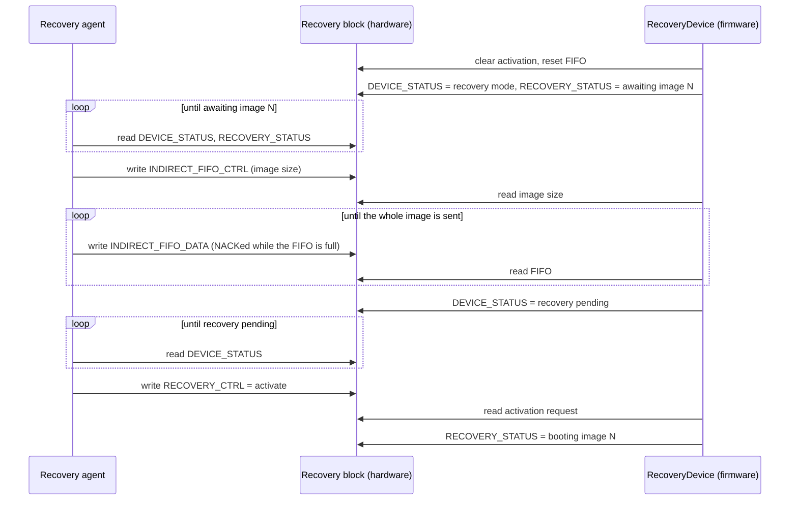

# Blocking OCP Recovery HAL

This HAL is for firmware on a device that receives images from a recovery
agent (usually the BMC) through the OCP Secure Firmware Recovery interface.
It covers the image FIFO (component memory space 0) and the status that goes
with it.

## Agent, hardware and firmware roles

The OCP recovery interface is a set of commands (`PROT_CAP`,
`DEVICE_STATUS`, `RECOVERY_CTRL`, `RECOVERY_STATUS`, `INDIRECT_FIFO_CTRL`,
`INDIRECT_FIFO_DATA` and others) that the agent sends as block reads and
block writes. The agent starts every transfer. The device (the recovery
hardware and the firmware behind it) only responds, and it has no way to send
anything to the agent on its own. To find out what the
device wants, the agent polls `DEVICE_STATUS` and `RECOVERY_STATUS`. It then
writes the image size, the image data and the activation request.

Over I3C, a target cannot stretch the clock, so the device has to answer a
read as soon as the agent asks for it. In practice this means hardware
answers the recovery commands. On Caliptra, the i3c-core's recovery handler
does this. It answers each read from a set of CSRs that hold the response
the agent will get next. It applies the agent's writes to those CSRs, puts
`INDIRECT_FIFO_DATA` writes into a FIFO, and checks the PEC on every
transfer. When the FIFO is full, it NACKs the agent's writes.

Device firmware never takes part in a transfer. It sets the
`DEVICE_STATUS` and `RECOVERY_STATUS` values that the agent will read next,
reads the values the agent has written to `INDIRECT_FIFO_CTRL` and
`RECOVERY_CTRL`, and drains the FIFO. On Caliptra it does all of this over
AXI.

## Key Abstractions

### `RecoveryDriver` Trait

The low-level interface to the hardware that answers the agent. The driver
sets the `DEVICE_STATUS` and `RECOVERY_STATUS` values that the agent reads.
It also reads the image size the agent wrote to `INDIRECT_FIFO_CTRL`, moves
words out of the FIFO without waiting, and reads and clears the activation
request the agent wrote to `RECOVERY_CTRL`.

### `RecoveryDevice`

Wraps a `RecoveryDriver` and a `Blocking` implementation, and runs the
sequence that Caliptra's `DmaRecovery` uses for each image. N is the image
index that the firmware asks for. Every arrow from the agent is a transfer
that the agent starts. `request_image` covers the steps up to reading the
image size, `ImageTransfer::read` covers the FIFO loop, and
`ImageTransfer::wait_for_activation` covers the rest.

`request_image` returns an `ImageTransfer`. The caller reads the image with
`ImageTransfer::read`, which waits until the FIFO has data, and then calls
`ImageTransfer::wait_for_activation`. After the last image, the caller reports
the result with `RecoveryDevice::complete` or `RecoveryDevice::fail`. The
agent sees each of these changes only when it next reads the status.

`Blocking::wait_for_notification` is called each time the device waits for
the agent. A `Blocking` implementation that polls can sleep there. The HAL has
no timeout: if the agent never responds, the wait does not end.
