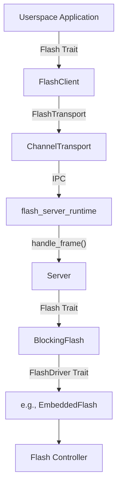

# Flash Service

The Flash Service provides a centralized interface for userspace applications to interact with on-chip and external flash memory. This is achieved via an IPC-based client-server architecture.

## Overview

Applications interact with flash through the `Flash` trait, typically using the `FlashIpcClient` implementation. All operations are blocking from the perspective of the caller.

### Key Features
- **Flexible Erase**: Support for multiple erase granularities (e.g., page vs. block) as reported by the hardware.
- **Unified Addressing**: A logical `FlashAddress` system that abstracts hardware-specific bank and page layouts.

## Usage

To use the flash service, initialize a `FlashIpcClient` with a transport over the channel to the flash service:

```rust
use hal_flash::{Flash, FlashAddress};
use openprot_flash_client_ipc::{ChannelTransport, FlashIpcClient};
use util_ipc::IpcHandle;

// 1. Connect to the flash service
let transport = ChannelTransport::new(IpcHandle::new(FLASH_SERVICE_HANDLE));
let mut flash = FlashIpcClient::new(transport)?;

// 2. Retrieve device geometry
let (total_size, page_size, erasable_bitmap) = flash.geometry();

// 3. Erase a block (using the default page size)
let addr = FlashAddress::new(0x1000);
flash.erase(addr, page_size)?;

// 4. Program data
flash.program(addr, b"Hello, Flash!")?;

// 5. Read data back
let mut buf = [0u8; 13];
flash.read(addr, &mut buf)?;
```

## The `Flash` Trait

The primary interface for flash operations:

- `geometry() -> (NonZero<usize>, PowerOf2Usize, u32)`: Returns the total capacity, the default/smallest page size, and a bitmap of all supported erase block sizes.
- `read(addr, buf)`: Reads data from the specified address.
- `erase(addr, size)`: Erases a block of the specified size. The size must be one of the values supported in the `erasable_bitmap`.
- `program(addr, data)`: Writes data to the specified address. Flash must be erased before programming.

### Understanding `erasable_bitmap`
The `erasable_bitmap` is a `u32` where each set bit `i` indicates that an erase block size of `2^i` bytes is supported.
- Bit 11 set (`0x800`) -> 2048-byte erase supported.
- Bit 16 set (`0x10000`) -> 64KB erase supported.

## Addressing

Flash memory is addressed using the `FlashAddress` type, which wraps a single 32-bit `offset`.

The server treats the offset as a byte position in a flat range from 0 to the size reported by `geometry()`, and rejects any read, program, or erase that does not fit in it. A target whose offsets carry more than a position, such as a partition selector, needs its own address handling in front of the server.

## Implementation Details

The service is built on several layers of abstraction:

### Crates

| Directory | Crate | Role |
|---|---|---|
| `api/` | `openprot_flash_api` | Opcodes and request layouts shared by client and server. |
| `client/` | `openprot_flash_client` | `FlashClient`, the `Flash` trait over any `FlashTransport`. No kernel types. |
| `client-ipc/` | `openprot_flash_client_ipc` | `ChannelTransport`, which carries requests over a kernel channel, and `FlashIpcClient`. Kernel only. |
| `server/` | `openprot_flash_server` | `Server`: decodes a request frame, checks it, and builds the response frame. No kernel types. |
| `server-runtime/` | `flash_server_runtime` | `run`: the wait loop that moves frames between a channel and `Server`. Kernel only. |

Host tests: `bazelisk test //services/flash:flash_host_tests`. They include the real client talking to the real server over an in-memory transport.

### IPC Layer
- **`Server`** is the trust boundary. Client address, erase size, and length are checked here, before `BlockingFlash` or the hardware driver is called. The erase size is a bit in the erasable-size bitmap, the erase address is aligned to that size, and every read, program, and erase range stays inside the device. A rejected request never reaches the flash.
- **`FlashClient`**: Implements the `Flash` trait by proxying calls to the server. It checks the length of each response.

A request is an opcode followed by its body. A response is a four-byte status, zero for success or an `ErrorCode`, followed by the reply.

### Hardware Abstraction
- **`FlashDriver` Trait**: Defines the low-level, often asynchronous, interface for hardware drivers.
- **`BlockingFlash`**: A wrapper that converts a `FlashDriver` into a synchronous `Flash` implementation using a provided blocking mechanism.

### Component Diagram


